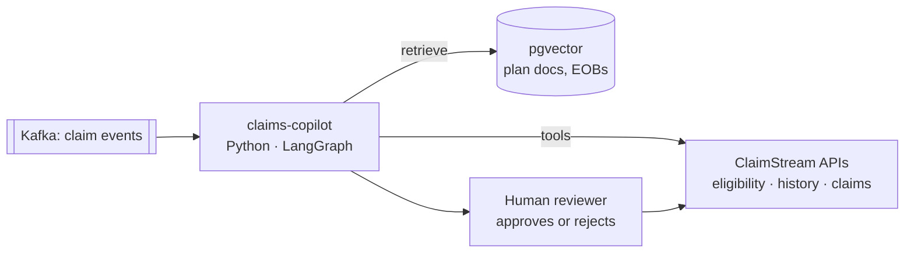

# ClaimStream

A distributed healthcare **claims adjudication platform**, built from scratch one milestone at a time to learn
how large-scale, multi-tier, event-driven systems are designed, built, tested and operated.

A claim flows through **submission → eligibility → pricing → adjudication → payment → remittance**.
By the end, ClaimStream does that across independent services over Kafka and gRPC, with idempotency,
sagas, circuit breakers, fraud scoring, caching and full observability.

On top of that sits an **AI layer, the Claims Copilot**: a LangChain / LangGraph agent that explains, triages and
answers questions about claims, while the deterministic engine stays the only thing that decides payment.

## 🤖 Claims Copilot (AI layer, planned for M8.5)

| Feature | What it does | AI technique |
|---|---|---|
| Fraud explainer | Turns a pended claim's signals (CLM-5004: 40 visits in a day) into a plain-English note for the reviewer | Prompting, structured output |
| Pend-queue triage agent | Looks at each pended claim, calls ClaimStream APIs as tools, suggests *retry*, *needs review* or *likely deny* | LangGraph agent, tool calling, human-in-the-loop |
| Member Q&A | Answers "Why did I pay $110?" from Maria's EOB and plan document | RAG on pgvector |
| Appeal drafter | Drafts an appeal or explanation letter for a denied claim (CLM-5003) | Prompt templates, guardrails |



**The rule:** the Copilot *advises*, a person *decides*. It never changes a payment, and PHI is masked before any
prompt leaves the service. See [ADR-0004](docs/adr/0004-claims-copilot-ai-layer.md).

## Quick start

Prerequisites: JDK 21, Docker Desktop running.

```bash
./mvnw verify                 # Checkstyle + unit + integration tests (Testcontainers)
docker compose up -d --build  # Postgres, Redis, Kafka + Intake Service
curl -s localhost:8080/actuator/health
curl -s localhost:8080/api/v1/platform
# M4: submit CLM-5002; run it twice and the second answer says Idempotent-Replayed: true
curl -i -X POST localhost:8080/api/v1/claims -H 'Content-Type: application/json' -H 'Idempotency-Key: maria-5002' \
  -d '{"claimId":"CLM-5002","memberId":"M-1001","providerNpi":"1234567890","dateOfService":"2026-10-20",
       "lines":[{"lineNumber":1,"cptCode":"99213","billed":150.00}]}'
docker compose down
```

| Service | Port |
|---|---|
| Intake Service | 8080 |
| PostgreSQL (`claimstream` / `claimstream`) | 5432 |
| Redis | 6379 |
| Kafka (host listener) | 9092 |

## Repository layout

```
claimstream/
├── pom.xml                  # parent POM: Java 21, Spring Boot 3.5, Checkstyle
├── claims-domain/           # plain-Java domain model: Money, Member, Claim...
├── adjudication-engine/     # rules chain, pricing, benefits, claim lifecycle
├── intake-service/          # REST intake with idempotency keys (Postgres + Redis)
├── claims-copilot/          # (M8.5) Python LangChain / LangGraph AI agent
├── config/checkstyle/       # code style rules
├── docker-compose.yml       # local stack
├── .github/workflows/ci.yml # CI: style → compile → tests → image
└── docs/
    ├── LEARNING.md          # study guide, one section per milestone
    ├── lessons/             # full milestone lessons
    └── adr/                 # architecture decision records
```

## Milestones

| # | Topic | Status |
|---|---|---|
| M0 | Big picture & setup | ✅ |
| M1 | Domain model (OOD) | ✅ |
| M2 | Adjudication rules engine (design patterns) | ✅ |
| M3 | Batch intake (multi-threading) | |
| M4 | Idempotency & concurrency correctness | ✅ |
| M5 | Event-driven services (Kafka, outbox) | |
| M6 | Reliability (timeouts, retries, circuit breaker, gRPC) | |
| M7 | Distributed transactions (saga) | |
| M8 | Fraud detection | |
| **M8.5** | **🤖 Claims Copilot: LangChain / LangGraph agent, tools, RAG on pgvector** | planned |
| M9 | Scaling & performance | |
| M10 | Observability & operations | |
| M11 | SDLC wrap-up | |

See [`docs/LEARNING.md`](docs/LEARNING.md) for the study guide.
