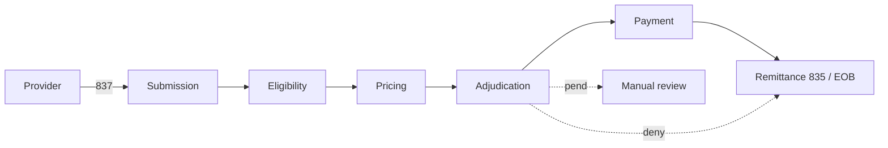
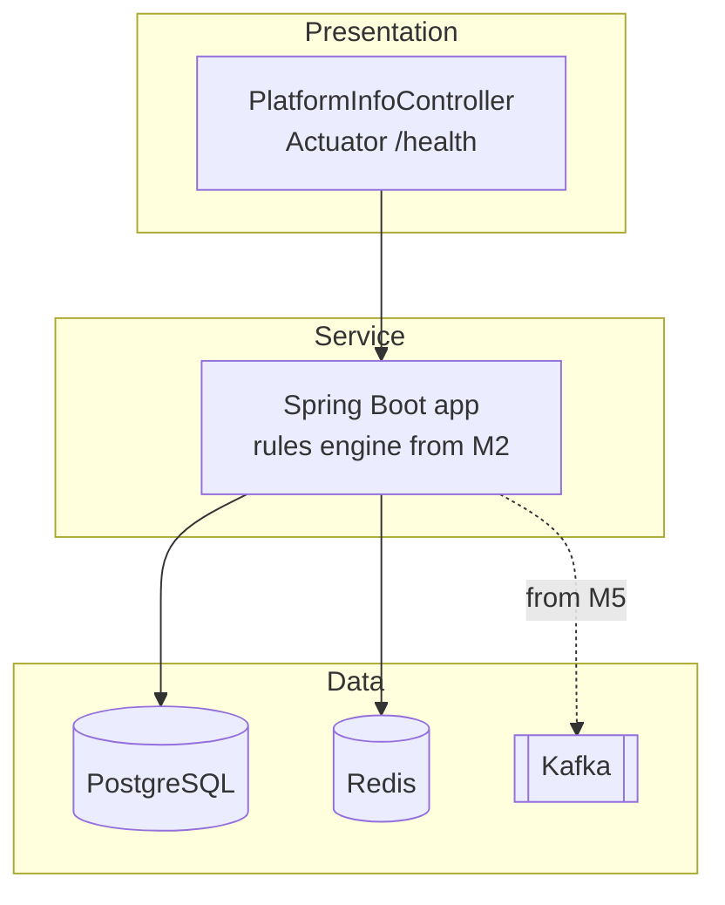

# ClaimStream Study Guide

One section per milestone: the idea, the diagram, the cards. Full lessons (walkthroughs, interview
questions, quizzes) live in [`docs/lessons/`](lessons/). Design decisions live in [`docs/adr/`](adr/).

**Running example:** Maria Lopez (`M-1001`, `GOLD-PPO`, $500 deductible, $350 met) visits Dr. Patel Family Clinic
(NPI `1234567890`, in-network). Claim `CLM-5001`: CPT `99213`, billed $150, allowed $110.

| Milestone | Topic | Lesson |
|---|---|---|
| M0 | Big picture, multi-tier architecture, repo setup | [M0-big-picture.md](lessons/M0-big-picture.md) |

---

## M0 – Big Picture & Setup

**Summary.** A payer turns a provider's claim into a payment decision in six stages: submission → eligibility →
pricing → adjudication → payment → remittance. We'll build that as ClaimStream, starting as a **modular monolith**
(one Maven multi-module repo) organised in three tiers: **presentation** (talk to the outside world),
**service** (apply the rules), **data** (Postgres, Redis, Kafka). M0 ships the skeleton: one `intake-service`
module, Docker Compose for the data tier, Checkstyle, Testcontainers tests and GitHub Actions CI.

**The payer pipeline**

**The three tiers in our code**

**CLM-5001 math** (computed for real in M2): allowed $110, deductible remaining $150 → all $110 goes to the deductible
→ plan pays 80% × $0 = **$0**, Maria owes **$110**, provider writes off $40.

**Remember cards**
- **Payer pipeline** = submission → eligibility → pricing → adjudication → payment → remittance.
- **Allowed amount** = contract price; billed − allowed = in-network write-off the member never pays.
- **Deductible first, then coinsurance**: plan pays coinsurance % only on what's left after the deductible.
- **Multi-tier** = presentation (talk) / service (think) / data (remember); each tier calls only the one below.
- **Modular monolith first**: split into services only when a boundary is proven and needs to scale independently.
- **Testcontainers** = real Postgres/Redis in Docker for tests; never trust H2 for concurrency behaviour.
- **CI** = fail fast and cheap first: style → compile → unit → integration → image.
- **Maven Wrapper (`mvnw`)** = same build tool version on every laptop and in CI.
