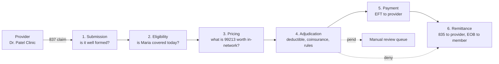
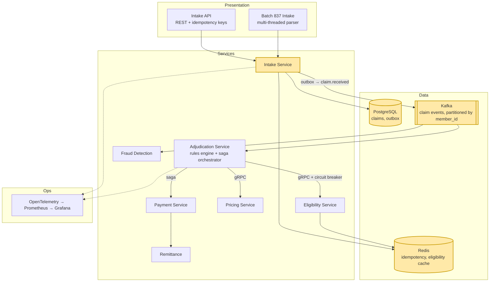
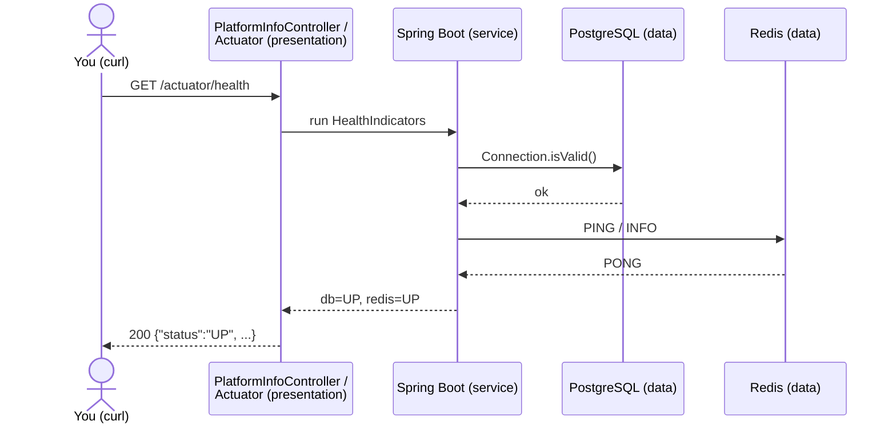

# M0 – Big Picture & Setup

> Goal: understand what a claims payer does end to end, see the system we're going to build,
> and get a repo where `docker compose up` and `./mvnw verify` both work on day one.

---

## 1. 🎯 The Problem

Dr. Patel Family Clinic just saw Maria Lopez (`M-1001`) for an office visit and sends claim `CLM-5001`
(CPT `99213`, billed $150). Somewhere, a payer has to answer five questions in order: *Is Maria covered?
What is this visit worth? What does her plan owe? Pay whom, how much? How do we tell everyone?*
ClaimStream is the machine that answers them, millions of times a day, without losing or double-paying a claim.
M0 doesn't adjudicate anything yet. It lays the foundation every later milestone builds on.

---

## 2. 🧠 Concept in Plain English: Multi-tier architecture

**Analogy: a restaurant.**
- The **dining room** (waiters, menus) is where customers interact. It takes orders, it doesn't cook.
- The **kitchen** follows the recipes. It doesn't care whether the order came from a table or a delivery app.
- The **pantry** stores ingredients. It doesn't know any recipes.

Each area can be renovated without rebuilding the others: you can add a drive-through window without changing a recipe.

**Technically:** a *multi-tier (n-tier) architecture* separates an application into layers with one job each:

| Tier | Job | In ClaimStream |
|---|---|---|
| **Presentation** | Talk to the outside world (HTTP/JSON, files, events), validate input shape | `api/` controllers, later the 837 file intake |
| **Service (business logic)** | Apply the rules: eligibility, pricing, adjudication | rules engine (M2), services (M5) |
| **Data** | Store and fetch state durably | PostgreSQL, Redis, Kafka |

Each tier only calls the tier **below** it. That keeps business rules testable without HTTP or a database,
and lets each tier scale on its own.

---

## 3. 📊 Diagrams

### 3a. What a payer does (business view)



### 3b. The END state we're building (M11)



Highlighted = what exists after **M0**: the Intake Service shell plus Postgres, Redis and Kafka running in Docker.

### 3c. CLM-5001 in M0 (just a health check, but it crosses all three tiers)



---

## 4. 🔍 Walkthrough with the Example

### The payer math for CLM-5001 (what M2 will compute)

| Step | Rule | CLM-5001 |
|---|---|---|
| 1 | Billed by provider | $150.00 |
| 2 | **Allowed** (in-network contract rate for 99213) | $110.00 |
| 3 | Contractual write-off (in-network: provider can't bill Maria for it) | $150 − $110 = **$40.00** |
| 4 | Deductible remaining | $500 − $350 = **$150.00** |
| 5 | Amount applied to deductible | min($110, $150) = **$110.00** |
| 6 | Left after deductible | $110 − $110 = $0.00 |
| 7 | Plan pays 80% of what's left | 80% × $0 = **$0.00** |
| 8 | Maria pays (deductible + 20% coinsurance) | $110 + $0 = **$110.00** |
| 9 | Maria's deductible met afterwards | $350 + $110 = $460 |

So CLM-5001 adjudicates as **PAID at $0 (applied to deductible)**. That's a real, common outcome: the claim is
processed and paid, the payment amount just happens to be zero, and the 835 tells the clinic to collect $110 from Maria.

For contrast, if Maria had already met $450 (only $50 left): $50 to deductible, $60 left, plan pays 80% × $60 = **$48**,
Maria pays $50 + $12 = **$62**.

### Through the code (M0)

1. `curl localhost:8080/api/v1/platform` hits **`PlatformInfoController`**
   (`intake-service/src/main/java/com/claimstream/intake/api/PlatformInfoController.java`): the presentation tier.
2. It returns a `PlatformInfo` **record** listing the six pipeline stages: the roadmap CLM-5001 will travel.
3. `curl localhost:8080/actuator/health` hits Spring Boot Actuator, which runs a health check against
   **Postgres** (`db`) and **Redis** (`redis`) using the settings in `application.yml`.
4. Each request runs on a **virtual thread** (`spring.threads.virtual.enabled: true`), a Java 21 feature we'll measure in M3.

---

## 5. 🛠 Build (what's in the repo)

| File | One-line purpose |
|---|---|
| `pom.xml` | Parent POM: Java 21, Spring Boot 3.5 versions, Checkstyle wired into `validate` |
| `intake-service/pom.xml` | First module: web, actuator, JDBC/Postgres, Redis, Testcontainers |
| `IntakeServiceApplication.java` | Spring Boot entry point |
| `api/PlatformInfoController.java` | Smoke endpoint listing the adjudication pipeline |
| `application.yml` | Ports, DB/Redis settings (overridable by env vars), virtual threads on |
| `PlatformInfoControllerTest.java` | Unit test: no Spring, no Docker, milliseconds |
| `StackWiringTest.java` | Integration test: real Postgres + Redis via Testcontainers, checks `/actuator/health` |
| `config/checkstyle/checkstyle.xml` | ~25 style rules that catch real bugs and readability problems |
| `docker-compose.yml` | Postgres 16, Redis 7, Kafka 3.9 (KRaft, no ZooKeeper), and the Intake Service |
| `intake-service/Dockerfile` | Multi-stage build: JDK image compiles, small JRE image runs |
| `.github/workflows/ci.yml` | On every push/PR: Checkstyle → compile → tests → compose check → Docker image build |
| `mvnw` + `.mvn/` | Maven Wrapper: everyone builds with the same Maven version |
| `docs/adr/0001-*.md` | Why a Maven multi-module monorepo |

---

## 6. ▶ Run & Verify

```bash
git clone https://github.com/Vindaru/claimstream.git && cd claimstream

# 1. Build + style check + all tests (Docker Desktop must be running for the Testcontainers test)
./mvnw verify
#   [INFO] You have 0 Checkstyle violations.
#   [INFO] Tests run: 3, Failures: 0, Errors: 0, Skipped: 0
#   [INFO] BUILD SUCCESS

# 2. Start the whole stack (first run builds the image, a few minutes on an Intel Mac)
docker compose up -d --build
docker compose ps          # postgres, redis, kafka: (healthy); intake-service: Up

# 3. Talk to it
curl -s localhost:8080/api/v1/platform
#   {"service":"claimstream-intake","milestone":"M0",
#    "pipeline":["SUBMISSION","ELIGIBILITY","PRICING","ADJUDICATION","PAYMENT","REMITTANCE"]}

curl -s localhost:8080/actuator/health
#   {"status":"UP","components":{"db":{"status":"UP",...},"redis":{"status":"UP",...},...}}

# 4. Peek at Kafka (empty until M5)
docker compose exec kafka /opt/kafka/bin/kafka-topics.sh --bootstrap-server localhost:9092 --list

# 5. Tear down (add -v to also wipe the Postgres volume)
docker compose down
```

There's no `POST /claims` for CLM-5001 yet. That arrives in M4, once M1–M2 give us a domain model and rules engine.

---

## 7. 🎤 Interview Corner

**Q1. Walk me through how a health insurance claim gets processed.**
Submission (837 received, validated for shape) → eligibility (member active on the date of service, benefits) →
pricing (allowed amount from the provider contract / fee schedule) → adjudication (apply deductible,
copay/coinsurance, edits like duplicates and medical necessity → pay, deny or pend) → payment (EFT) →
remittance (835 to provider, EOB to member). I'd anchor it on a real claim: Maria's $150 office visit is allowed at $110,
fully absorbed by her remaining deductible, so the plan pays $0 and she owes $110.

**Q2. What is a multi-tier architecture and why use it?**
Separating presentation, business logic and data so each has one reason to change. Benefits: testability
(rules engine tested with no HTTP or DB), independent scaling (more API pods without touching the DB), and swappable
edges (add a batch 837 intake without rewriting adjudication). Cost: more boundaries and mapping code, and
extra latency if tiers are split across the network.

**Q3. Why start with a modular monolith instead of microservices on day one?**
(STAR) *Situation:* new platform, domain boundaries not yet proven. *Task:* ship fast without painting us into a corner.
*Action:* one repo, Maven modules per future service, clear package boundaries, events planned from the start.
*Result:* one build, one deploy, easy refactors; when a boundary proves stable and needs independent scaling
(M5), we extract it. Splitting too early gives you a *distributed monolith*: all the network failures, none of the independence.

**Q4. Why Testcontainers instead of H2 or mocks for DB tests?**
H2 isn't Postgres: different SQL dialect, locking, constraint behaviour. Bugs like a race on a unique constraint (M4)
only show up on the real engine. Testcontainers spins up the real Postgres in Docker per test run.
Cost: slower tests and Docker required, so we keep most tests as fast unit tests (test pyramid).

**Q5. What belongs in a CI pipeline for a service like this?**
Fail fast and cheap first: style/static checks → compile → unit tests → integration tests → build the artifact/image →
(later) contract tests, security scan, deploy to staging, smoke tests. Every PR must be green before merge, so `main` is always releasable.

**System-design follow-up: "What if claim volume is 100x?"**
The tiers let us scale each part separately: stateless intake pods behind a load balancer scale horizontally; Kafka
absorbs bursts (consumers process at their own pace); adjudication consumers scale up to the number of partitions;
Postgres becomes the bottleneck, so we add read replicas, caching for eligibility (Redis) and eventually shard by
`member_id`. All of that is M5–M9.

**Common mistakes**
- Business rules in controllers ("fat controllers"): untestable and duplicated when a second entry point (batch) appears.
- Microservices first, then discovering every request needs 5 synchronous hops.
- Tests that only pass on the author's laptop (H2, hard-coded ports, no CI).
- Skipping the domain: not knowing *allowed vs billed* or what *pend* means is an instant credibility hit in a payer interview.

---

## 8. 📌 Remember Cards

- **Payer pipeline** = submission → eligibility → pricing → adjudication → payment → remittance.
- **Allowed amount** = contract price; billed − allowed = in-network write-off the member never pays.
- **Deductible first, then coinsurance**: plan pays coinsurance % only on what's left after the deductible.
- **Multi-tier** = presentation (talk) / service (think) / data (remember); each tier calls only the one below.
- **Modular monolith first**: split into services only when a boundary is proven and needs to scale independently.
- **Testcontainers** = real Postgres/Redis in Docker for tests; never trust H2 for concurrency behaviour.
- **CI** = fail fast and cheap first: style → compile → unit → integration → image.
- **Maven Wrapper (`mvnw`)** = same build tool version on every laptop and in CI.

---

## 9. ✅ Quick Quiz

1. CLM-5001 was billed $150 and allowed $110. Who absorbs the $40 difference, and why can't Maria be billed for it?
2. A teammate puts the "is the member eligible?" check inside the REST controller. Which tier should it live in,
   and what concrete problem shows up in M3 when we add batch 837 intake?
3. Our `StackWiringTest` uses Testcontainers instead of an in-memory H2 database. Give one bug H2 could hide.

*(Answers held back until you reply.)*
