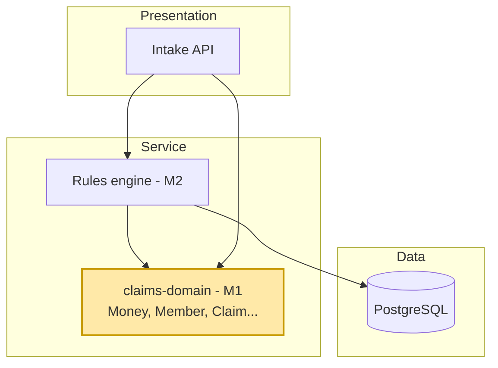
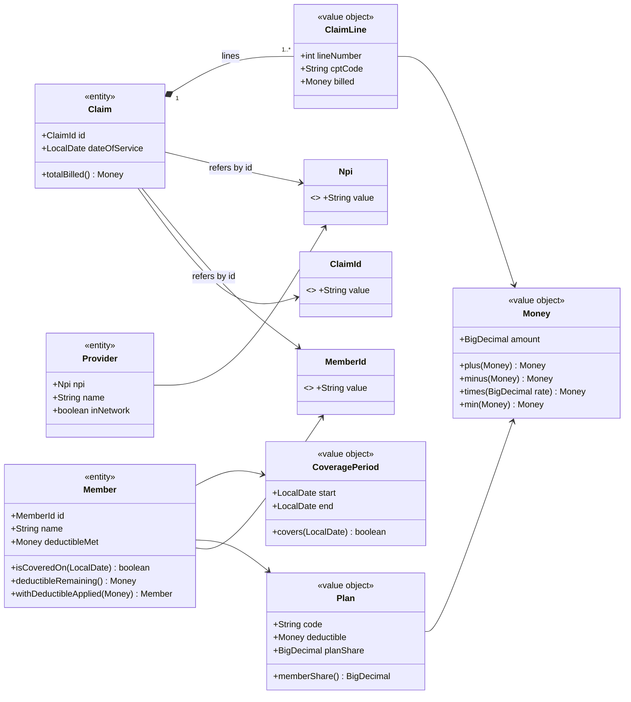
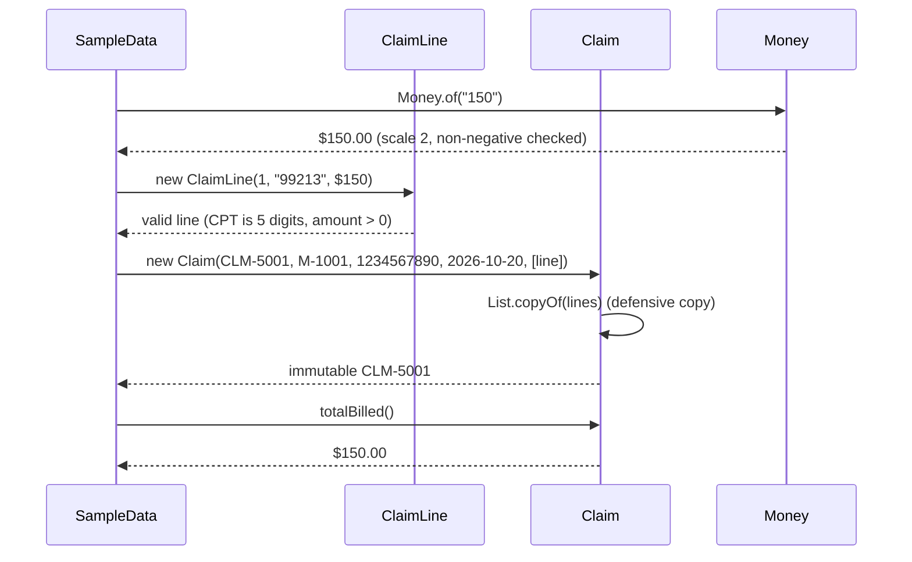
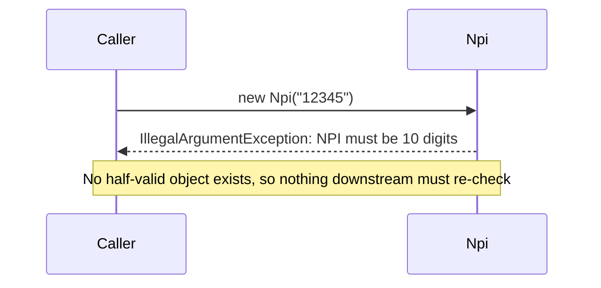

# M1 – Domain Model (OOD)

> Goal: describe Maria, Dr. Patel, the GOLD-PPO plan and CLM-5001 as Java objects that can't hold bad data,
> can't be changed behind your back, and get the money exactly right.

---

## 1. 🎯 The Problem

Before we can adjudicate CLM-5001 we need a shared vocabulary in code. If `memberId` and `npi` are both plain `String`s,
someone will eventually pass Dr. Patel's NPI where Maria's member id belongs. If money is a `double`, the plan will
underpay by fractions of a cent across millions of claims. If a `Member` can be modified anywhere, a half-finished calculation
can leave Maria's deductible wrong for the next claim. M1 builds a small domain model that makes those bugs impossible.

---

## 2. 🧠 Concept in Plain English

**Analogy: a hospital's paperwork.**
- A **patient wristband** (Maria, M-1001) identifies one specific person. If her address changes, she is still the same patient.
  That's an **entity**: identity matters, not the current values.
- A **$20 bill** has no identity. Any $20 bill is as good as any other, and you don't "edit" a bill, you get change.
  That's a **value object**: equal when the values are equal, and never modified.
- A **pre-printed form** won't let you write letters in the "NPI (10 digits)" boxes. That's **encapsulation with invariants**:
  the object checks its own rules at the door, so nobody downstream has to re-check.

**Technically:** object-oriented design (OOD) groups data with the rules that keep it valid. We make domain objects
**immutable** (Java `record`s, defensive copies), give each concept its own **type** (`MemberId`, `Npi`, `Money`),
and validate in the **constructor** so an invalid object can never exist.

---

## 3. 📊 Diagrams

### 3a. Where M1 sits



`claims-domain` is plain Java: no Spring, no database, no HTTP. Every service will depend on it; it depends on nothing.

### 3b. Class diagram



Notice that `Claim` holds `MemberId` and `Npi`, not a whole `Member` or `Provider`. More on why in the walkthrough.

### 3c. CLM-5001 being built



### 3d. A bad claim never gets built



---

## 4. 🔍 Walkthrough with the Example

All files are under `claims-domain/src/main/java/com/claimstream/domain/`.

1. **`Money`** wraps a `BigDecimal`, forces 2 decimal places, and refuses negatives. `Money.of("150")` is CLM-5001's billed amount.
   `0.1 + 0.2` as `double` is `0.30000000000000004`; as `Money` it's exactly `$0.30` (see `MoneyTest`).
2. **`Plan`** = GOLD-PPO: `deductible = $500`, `planShare = 0.80`. `memberShare()` derives Maria's 20% coinsurance, so the
   two numbers can never disagree.
3. **`Member`** = Maria. `deductibleRemaining()` = $500 − $350 = **$150**. `withDeductibleApplied($110)` returns a **new**
   Member with $460 met; the original still says $350. Two snapshots of Maria are still `equal` because entities compare by id.
4. **`CoveragePeriod`** answers "is M-2002 covered on 2026-10-20?" Coverage ended 2026-09-30, so **no**. That is the fact
   M2 will use to deny CLM-5003.
5. **`Provider`** = Dr. Patel, NPI `1234567890`, in-network. `Npi` rejects anything that isn't 10 digits.
6. **`ClaimLine`** = line 1, CPT `99213`, $150. **`Claim`** = CLM-5001 with that line. Its constructor copies the list,
   so even if a caller keeps and edits the original list, CLM-5001 can't change (`ClaimTest`).
7. **The math**, using only these building blocks (`SampleCastTest`):

   | Step | Code | Result |
   |---|---|---|
   | Write-off | `billed.minus(allowed)` | $40 |
   | To deductible | `allowed.min(maria.deductibleRemaining())` | min($110, $150) = $110 |
   | After deductible | `allowed.minus(toDeductible)` | $0 |
   | Plan pays | `afterDeductible.times(0.80)` | $0 |
   | Maria pays | `toDeductible.plus(afterDeductible.minus(planPays))` | $110 |

8. **Villains:** CLM-5002 has identical fields to CLM-5001 but a different id, so the model treats it as a different claim.
   Spotting it as a duplicate is the rules engine's job in M2. CLM-5004 comes with 39 earlier Quick Care visits on the same day,
   ready for fraud detection.

**Why `Claim` refers to the member by id.** If CLM-5001 embedded a copy of Maria, that copy would show $350 met forever,
even after the claim changed it to $460. Holding only `M-1001` means whoever processes the claim looks up the current Maria.
It also keeps the claim small enough to send as a Kafka message in M5.

---

## 5. 🛠 Build

| File | One-line purpose |
|---|---|
| `claims-domain/pom.xml` | New module: plain Java, only JUnit and AssertJ for tests |
| `Money.java` | Non-negative dollars to the cent; plus, minus, times, min |
| `MemberId.java`, `Npi.java`, `ClaimId.java` | Typed ids with format checks so ids can't be swapped |
| `Plan.java` | Deductible and plan share; derives member coinsurance |
| `CoveragePeriod.java` | Start and inclusive end date; `covers(date)` |
| `Member.java` | Entity; deductible remaining; returns a new Member when the deductible is applied |
| `Provider.java` | Entity identified by NPI; in-network flag |
| `ClaimLine.java` | One billed service: line number, CPT, billed amount |
| `Claim.java` | Entity; ids of member and provider, date, immutable lines, `totalBilled()` |
| `SampleData.java` (test) | The running cast: Maria, M-2002, Dr. Patel, Quick Care, CLM-5001..5005 |
| `MoneyTest`, `MemberTest`, `ClaimTest`, `ValueObjectValidationTest`, `SampleCastTest` | 32 fast unit tests |
| `docs/adr/0002-*.md` | Why records, typed ids and BigDecimal money |

### SOLID, with our code

| Principle | In one line | Where you see it now |
|---|---|---|
| **S**ingle Responsibility | One reason to change | `Money` only does arithmetic; `CoveragePeriod` only answers date questions; `Member` doesn't price or adjudicate |
| **O**pen/Closed | Add behaviour without editing working code | Not much yet. M2's pricing **Strategy** and rule **Chain** add a new claim type or rule as a new class |
| **L**iskov Substitution | A subtype must keep the parent's promises | Records are `final`, so nobody can subclass `Money` and break "never negative". We revisit it with M2's rule interface |
| **I**nterface Segregation | Small, focused interfaces | Arrives in M2: a rule implements one method, `evaluate(claim)`, not a fat "ClaimProcessor" |
| **D**ependency Inversion | Depend on abstractions, not details | `claims-domain` depends on nothing: no Spring, no JDBC. Services depend on the domain, never the reverse |

Being honest about where a principle *doesn't* apply yet is a good interview signal. Forcing all five into a value-object
layer would mean adding abstractions nobody needs.

---

## 6. ▶ Run & Verify

```bash
git checkout m1-domain-model      # or main after the PR is merged
./mvnw -pl claims-domain verify   # just the domain module: no Docker needed, about 5 seconds
```

Expected:

```
[INFO] You have 0 Checkstyle violations.
[INFO] Tests run: 14, Failures: 0, Errors: 0 -- in ValueObjectValidationTest
[INFO] Tests run: 5,  Failures: 0, Errors: 0 -- in ClaimTest
[INFO] Tests run: 2,  Failures: 0, Errors: 0 -- in SampleCastTest
[INFO] Tests run: 5,  Failures: 0, Errors: 0 -- in MemberTest
[INFO] Tests run: 6,  Failures: 0, Errors: 0 -- in MoneyTest
[INFO] Tests run: 32, Failures: 0, Errors: 0, Skipped: 0
[INFO] BUILD SUCCESS
```

`./mvnw verify` runs everything (35 tests, including M0's Testcontainers test; Docker must be running).

Try breaking it on purpose (a good SDET habit):
- In `SampleData`, change Dr. Patel's NPI to `"12345"` → every test fails at class load with `NPI must be 10 digits`.
- In `Money`, delete the negative check → `MoneyTest.refusesToGoNegative` goes red.

There's still no HTTP endpoint for CLM-5001; the REST intake API arrives in M4.

---

## 7. 🎤 Interview Corner

**Q1. What's the difference between an entity and a value object?**
An entity has an identity that outlives its attribute changes (Maria is M-1001 whatever her deductible says); equality is by id.
A value object is defined only by its values ($150 is $150), is immutable, and equality is by value. In our code `Member`,
`Provider` and `Claim` are entities (custom `equals` on the id); `Money`, `Npi`, `ClaimLine` are value objects (record equality).

**Q2. Why never use `double` for money?**
Binary floating point can't represent most decimal fractions exactly: `0.1 + 0.2 != 0.3`. Across millions of claims those
errors add up to real dollars and to reconciliations that never balance. Use `BigDecimal` with a fixed scale and an explicit
rounding mode (we use HALF_EVEN, banker's rounding), wrapped in a `Money` type so nobody can forget.

**Q3. Why make domain objects immutable?**
(STAR) *Situation:* in a claims system the same Member is read by many threads (M3) and services (M5). *Task:* stop one
calculation from corrupting another. *Action:* records with validated compact constructors, `List.copyOf` for collections,
and "wither" methods (`withDeductibleApplied`) that return new objects. *Result:* objects are thread-safe by construction,
easy to reason about, and safe to cache; the cost is a little extra allocation, which is negligible.

**Q4. What is primitive obsession and how did you avoid it?**
Using raw `String`/`int` for domain concepts. A method `check(String memberId, String npi)` compiles even if you swap the arguments.
`check(MemberId, Npi)` doesn't. Typed ids also give one place to validate the format.

**Q5. Where do validation rules live?**
Invariants that are always true (NPI is 10 digits, money is non-negative, coverage can't end before it starts) live in the
object's constructor, so an invalid object can't exist. Business decisions that depend on context (is this claim a duplicate?
is the member eligible *for this date*?) live in the rules engine (M2), not in the data class.

**System-design follow-up: "What if traffic is 100x?"**
Immutable value objects are what make scaling safe: they can be shared across threads without locks (M3), serialized into
Kafka messages without aliasing bugs (M5), and cached in Redis without anyone mutating a cached copy (M9). Referencing
members by id instead of embedding them keeps messages small and avoids stale copies spreading through the system.

**Common mistakes**
- Anemic setters everywhere (`member.setDeductibleMet(...)`) so any code can put an object into an invalid state.
- Returning the internal `List` so callers can add lines to a claim after validation.
- Using `double` or `float` for money, or `BigDecimal.equals` (which says `150` ≠ `150.00`) instead of a normalised scale.
- Embedding full objects in messages, then fighting stale data.
- Inventing interfaces and factories for every class "for SOLID" when there's only one implementation.

---

## 8. 📌 Remember Cards

- **Entity** = identity matters (Maria, M-1001); equality by id.
- **Value object** = only values matter ($150); immutable; equality by value.
- **Never `double` for money**: `BigDecimal`, fixed scale, explicit rounding, wrapped in `Money`.
- **Validate in the constructor**: an invalid object should be impossible to create.
- **Defensive copy**: `List.copyOf` so callers can't change your internals.
- **Immutable = thread-safe by construction**; change by returning a new object (`withDeductibleApplied`).
- **Typed ids beat Strings**: `MemberId` and `Npi` can't be swapped by accident.
- **Refer across aggregates by id**, not by embedding objects: smaller messages, no stale copies.

---

## 9. ✅ Quick Quiz

1. `Money.of("150").equals(Money.of("150.00"))` returns `true` in our code, but `new BigDecimal("150").equals(new BigDecimal("150.00"))`
   returns `false`. Which line in `Money` makes the difference, and why does it matter for a duplicate-payment check?
2. `Member` is a record, but we overrode `equals` and `hashCode`. What would go wrong in a `Set<Member>` holding
   "Maria before CLM-5001" and "Maria after CLM-5001" if we hadn't?
3. Why does `Claim` store `MemberId` instead of a full `Member` object? Give two reasons.

*(Answers held back until you reply.)*
