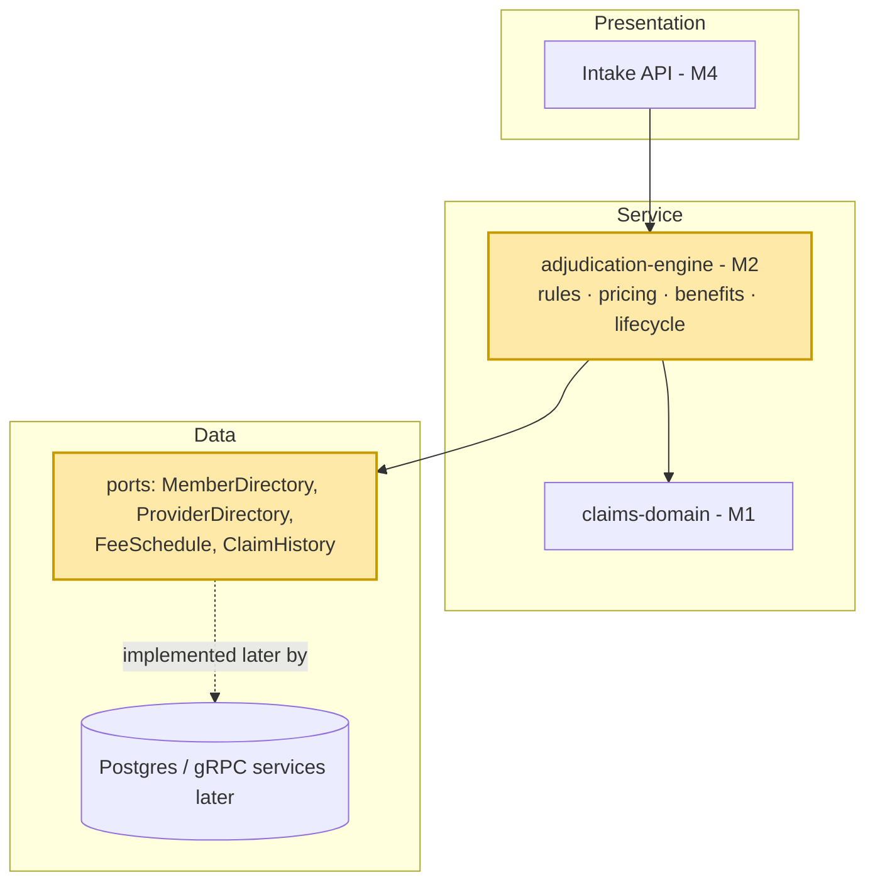
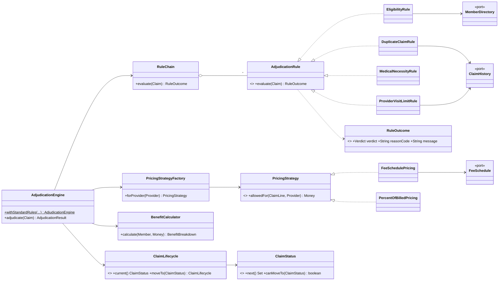
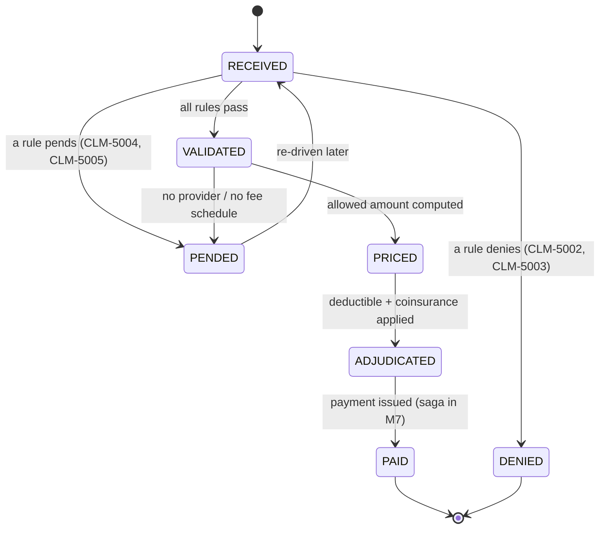
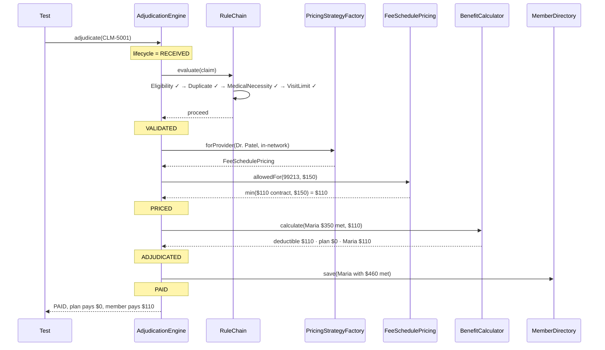
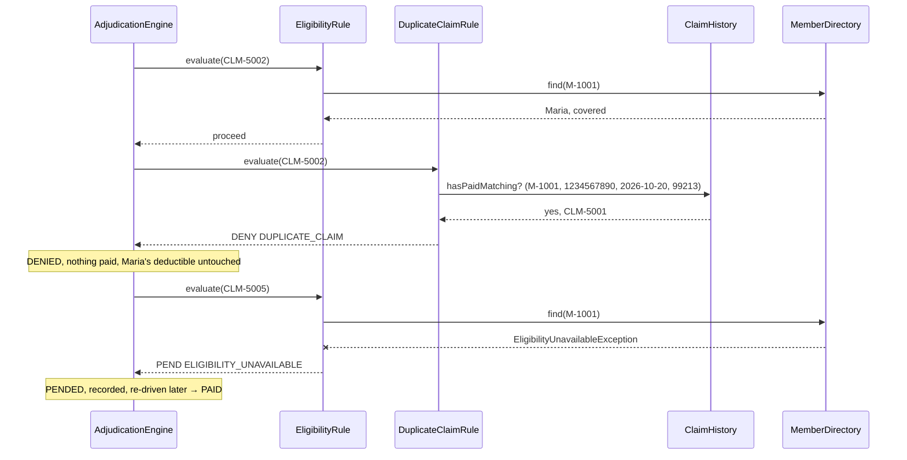

# M2 – Adjudication Rules Engine (Design Patterns)

> Goal: decide PAID, DENIED or PENDED for every sample claim, with each business decision in its own small class,
> so adding a rule or a pricing method never means editing the engine.

---

## 1. 🎯 The Problem

M1 gave us Maria and CLM-5001 as objects. Now something has to *decide*: is she covered, is this a duplicate, is the service
covered, what is it worth, who pays what? Written as one giant `if/else` method, that logic becomes untestable and every new
payer rule risks breaking an old one. M2 builds an engine where each decision is a separate class plugged together with four
classic design patterns, and runs all five sample claims through it.

---

## 2. 🧠 Concept in Plain English

**Analogy: a claims office.**
- **Chain of Responsibility = the inspection line.** The claim slides past inspectors: eligibility clerk, duplicate checker,
  medical reviewer, fraud desk. Each checks one thing and either passes it on or pulls it off the line with a reason.
- **Strategy = interchangeable price lists.** In-network claims are priced from the contract binder; out-of-network claims at
  60% of the bill. Same question ("what's this worth?"), different method, swappable.
- **Factory = the supervisor who hands you the right binder.** You don't pick the price list yourself; you say "Dr. Patel" and
  get the in-network binder.
- **State = the claim's status stamp.** A claim stamped PAID can't be re-stamped PRICED. The stamp itself knows what may come next.

**Technically:** design patterns are named, reusable solutions to recurring design problems. They matter in interviews because
they give you shared vocabulary *and* trade-offs: each one adds a class or an interface, so you use it only when it removes a real
problem.

---

## 3. 📊 Diagrams

### 3a. Where M2 sits



### 3b. Which pattern solves which problem

| Problem | Pattern | Our classes | Without it |
|---|---|---|---|
| Many independent checks, any can stop the claim, order matters | **Chain of Responsibility** | `AdjudicationRule`, `RuleChain`, `EligibilityRule`, `DuplicateClaimRule`, `MedicalNecessityRule`, `ProviderVisitLimitRule` | One 300-line method; every new edit touches it |
| Several ways to compute the allowed amount | **Strategy** | `PricingStrategy`, `FeeSchedulePricing`, `PercentOfBilledPricing` | `if (inNetwork) ... else ...` repeated wherever we price |
| Choosing the right strategy without callers knowing the classes | **Factory** | `PricingStrategyFactory` | Callers `new` concrete classes and copy the selection logic |
| Claim status must follow legal transitions only | **State** | `ClaimStatus` (each constant defines `next()`), `ClaimLifecycle` | Scattered `if (status == ...)` checks; a claim jumps from PAID back to PRICED |
| Engine must not care where data comes from | **Ports (Dependency Inversion)** | `MemberDirectory`, `ProviderDirectory`, `FeeSchedule`, `ClaimHistory` | Engine hard-wired to a database; untestable without one |

### 3c. Class diagram



### 3d. Claim lifecycle (State)



### 3e. CLM-5001 through the engine



### 3f. Failure paths: CLM-5002 (duplicate) and CLM-5005 (Eligibility down)



---

## 4. 🔍 Walkthrough with the Example

All production code is in `adjudication-engine/src/main/java/com/claimstream/adjudication/`.

**CLM-5001 (happy path).** `AdjudicationEngine.adjudicate` starts a `ClaimLifecycle` at RECEIVED and asks `RuleChain` to
evaluate the claim:
1. `rules/EligibilityRule` calls `MemberDirectory.find(M-1001)`; Maria exists and `isCoveredOn(2026-10-20)` → proceed.
2. `rules/DuplicateClaimRule` asks `ClaimHistory.hasPaidMatching` → nothing paid yet → proceed.
3. `rules/MedicalNecessityRule` checks 99213 is in the covered list → proceed.
4. `rules/ProviderVisitLimitRule` counts Dr. Patel's claims for the day: 1 ≤ 25 → proceed.

Lifecycle → VALIDATED. `pricing/PricingStrategyFactory.forProvider(Dr. Patel)` returns `FeeSchedulePricing` (in-network),
which looks up the contracted $110 and takes `min($110, $150)`. Lifecycle → PRICED. `benefits/BenefitCalculator` applies
min($110, $150 remaining) = $110 to the deductible, leaving $0 for the plan's 80%. Lifecycle → ADJUDICATED. The engine saves
Maria with $460 met, then → PAID and records the claim in `ClaimHistory`.

**The villains** (`SampleClaimsTest`):

| Claim | Stopped by | Why | Result |
|---|---|---|---|
| CLM-5002 | `DuplicateClaimRule` | CLM-5001 with the same member, NPI, date and CPT is already PAID | DENIED `DUPLICATE_CLAIM` |
| CLM-5003 | `EligibilityRule` | M-2002's coverage ended 2026-09-30 | DENIED `COVERAGE_TERMINATED` |
| CLM-5004 | `ProviderVisitLimitRule` | Quick Care's 40th claim for 2026-10-20 (limit 25) | PENDED `PROVIDER_VISIT_LIMIT` |
| CLM-5005 | `EligibilityRule` | `MemberDirectory` throws `EligibilityUnavailableException` | PENDED `ELIGIBILITY_UNAVAILABLE`, then PAID on retry |

**The 80% math finally shows up.** `PricingAndBenefitsTest` runs Maria's *next* visit after CLM-5001: allowed $150,
$40 finishes her deductible ($500 − $460), the plan pays 80% of the remaining $110 = **$88**, and Maria pays $40 + $22 = **$62**.

**Why eligibility runs first.** Order is a design decision: a claim for a non-member should be denied before we spend effort
on duplicate searches or pricing. Rules that stop most claims cheaply go first.

---

## 5. 🛠 Build

| File | One-line purpose |
|---|---|
| `adjudication-engine/pom.xml` | New module; depends on `claims-domain` and reuses its `SampleData` via a test-jar |
| `ClaimStatus.java` | State pattern: each status lists its allowed next statuses |
| `ClaimLifecycle.java` | Immutable history of statuses; refuses illegal moves |
| `rules/AdjudicationRule.java` | The one-method interface every rule implements |
| `rules/RuleOutcome.java` | CONTINUE / DENY / PEND with a reason code |
| `rules/RuleChain.java` | Runs rules in order, stops at the first DENY or PEND |
| `rules/EligibilityRule.java` | Member exists and is covered on the date; pends if the lookup fails |
| `rules/DuplicateClaimRule.java` | Denies a claim matching one already paid |
| `rules/MedicalNecessityRule.java` | Denies services not on the covered list |
| `rules/ProviderVisitLimitRule.java` | Pends when a provider exceeds 25 claims a day (placeholder for M8 fraud) |
| `pricing/PricingStrategy.java` | Strategy interface: allowed amount for a line |
| `pricing/FeeSchedulePricing.java` | In-network: contracted rate, capped at billed |
| `pricing/PercentOfBilledPricing.java` | Out-of-network: 60% of billed |
| `pricing/PricingStrategyFactory.java` | Factory: picks the strategy from network status |
| `pricing/FeeSchedule.java`, `NoFeeScheduleException.java` | Port for contracted rates; missing rate pends the claim |
| `benefits/BenefitCalculator.java`, `BenefitBreakdown.java` | Deductible first, then plan share; who pays what |
| `ports/*.java` | `MemberDirectory`, `ProviderDirectory`, `ClaimHistory`, `EligibilityUnavailableException` |
| `AdjudicationEngine.java`, `AdjudicationResult.java` | Orchestrates the lifecycle; `withStandardRules` wires the default setup |
| Tests: `InMemoryWorld`, `ClaimLifecycleTest`, `RuleChainTest`, `PricingAndBenefitsTest`, `SampleClaimsTest` | 22 tests, all in memory |
| `claims-domain` | `SampleData` made public and published as a test-jar; adds `quickCarePatient` |

**SOLID now has real examples:**
- **Open/Closed:** a new edit (say, "timely filing: deny claims older than 180 days") is a new `AdjudicationRule` class added
  to the list. `RuleChain` and the engine don't change.
- **Liskov:** any `PricingStrategy` can replace another; the engine only relies on "returns an allowed amount ≤ billed".
- **Interface Segregation:** a rule implements one method. Nothing forces it to know about pricing or payment.
- **Dependency Inversion:** the engine depends on `MemberDirectory`, not on Postgres or gRPC. Tests pass in an in-memory map.

---

## 6. ▶ Run & Verify

```bash
git checkout m2-rules-engine          # or main after the PR is merged
./mvnw -pl adjudication-engine -am verify   # domain + engine, no Docker needed
```

Expected (the table is printed by `SampleClaimsTest.allFiveInArrivalOrder`):

```
Claim     Status   Allowed  Plan pays  Member pays  Reason
CLM-5001  PAID     $110.00  $0.00      $110.00
CLM-5002  DENIED   -        -          -            DUPLICATE_CLAIM
CLM-5003  DENIED   -        -          -            COVERAGE_TERMINATED
CLM-5004  PENDED   -        -          -            PROVIDER_VISIT_LIMIT
CLM-5005  PENDED   -        -          -            ELIGIBILITY_UNAVAILABLE
[INFO] Tests run: 22, Failures: 0, Errors: 0, Skipped: 0   (adjudication-engine)
[INFO] Tests run: 32, Failures: 0, Errors: 0, Skipped: 0   (claims-domain)
[INFO] BUILD SUCCESS
```

`./mvnw verify` runs all 57 tests, including M0's Testcontainers test (Docker must be running).

Break it on purpose:
- Swap `EligibilityRule` and `DuplicateClaimRule` in `withStandardRules`. Everything still passes, which shows the order is a
  *performance and clarity* choice here, not a correctness one. Discuss why.
- Change `MAX_CLAIMS_PER_PROVIDER_PER_DAY` to 50 → `clm5004IsPendedAsTheFortiethVisitInOneDay` goes red.

Still no HTTP endpoint for CLM-5001; the REST API arrives in M4.

---

## 7. 🎤 Interview Corner

**Q1. Walk me through how you'd design a claims rules engine.**
(STAR) *Situation:* payer rules change constantly and each is independent (eligibility, duplicates, medical necessity, fraud).
*Task:* add or reorder rules without touching the engine or breaking others. *Action:* a Chain of Responsibility of single-method
rule classes returning CONTINUE/DENY/PEND with a reason code; pricing as a Strategy chosen by a Factory; a State-pattern lifecycle;
every external lookup behind an interface. *Result:* each rule is unit-tested alone, the engine is ~60 lines, and new rules are
new classes. All five sample claims land in the right state.

**Q2. Strategy vs State: they look the same in a class diagram. What's the difference?**
Both put behaviour behind an interface. **Strategy**: the *client chooses* an algorithm and it doesn't change during the operation
(in-network vs out-of-network pricing). **State**: the object's *own condition* determines behaviour and transitions happen over
time (RECEIVED → VALIDATED → ...). Ask "who picks it, and does it change as the object lives?"

**Q3. Why Chain of Responsibility instead of a list of `if` statements?**
Each rule is isolated, named and testable; rules can be reordered or toggled by configuration; a new rule is a new class (Open/Closed).
Cost: more classes, and the flow is spread out, so we keep the chain wiring in one place (`withStandardRules`) and log the
stopping rule's reason code.

**Q4. When is a Factory over-engineering?**
When there's one implementation and no realistic second. Ours earns its place because the choice (network status today; contract
type, capitation or state mandates tomorrow) would otherwise be copied into every caller.

**Q5. How do you test a rules engine?**
Pyramid: one unit test per rule with tiny inputs; strategy tests for pricing edge cases (allowed > billed, missing rate); lifecycle
tests for illegal transitions; then scenario tests that push the five sample claims through the real engine with in-memory
ports. No database needed, so the whole suite runs in under a second.

**System-design follow-up: "What if traffic is 100x?"**
The engine is stateless and its objects are immutable, so we run many instances in parallel (threads in M3, consumer instances in
M5). The bottlenecks become the ports: `ClaimHistory` duplicate lookups need an index on (member, NPI, date) and later a cache;
eligibility moves behind a cache (M9). Rule order also matters at scale: cheap, high-rejection rules first.

**Common mistakes**
- A "god" adjudicate method with nested `if`s, impossible to test one rule in isolation.
- Mixing pricing into rules, so changing a fee schedule risks breaking eligibility.
- Treating "service down" as a denial: CLM-5005 must pend, never deny.
- Mutable status fields set from anywhere instead of a state machine with legal transitions.
- Patterns for their own sake: interfaces with one implementation and no second in sight.

---

## 8. 📌 Remember Cards

- **Chain of Responsibility** = a line of handlers; each passes or stops the request.
- **Strategy** = same question, swappable algorithm, chosen by the caller (in- vs out-of-network pricing).
- **Factory** = hand me the right object; callers don't know the concrete classes.
- **State** = the object's status decides what's allowed next; illegal transitions are refused.
- **Strategy vs State**: who chooses it, and does it change over the object's life?
- **Deny vs pend**: deny = a business "no"; pend = "can't decide now" (system down, needs review). Never deny because a service is down.
- **Ports** = interfaces for the outside world, so the engine runs in memory in tests.
- **Rule order** = cheapest, most decisive rules first.

---

## 9. ✅ Quick Quiz

1. CLM-5005 hits `EligibilityUnavailableException`. Why does the engine **pend** instead of **deny**, and what would go wrong for
   Dr. Patel and Maria if it denied?
2. You need a new rule: "deny claims submitted more than 180 days after the date of service." Which files do you create or change,
   and which files stay untouched? Which SOLID principle does that show?
3. `PricingStrategyFactory` and `ClaimStatus` both replace an `if/else`. One is Strategy+Factory, the other is State. In one
   sentence each, why is pricing *not* a State and the lifecycle *not* a Strategy?

*(Answers held back until you reply.)*
