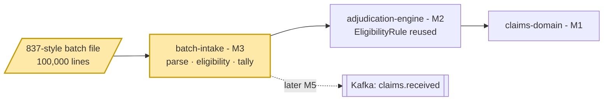
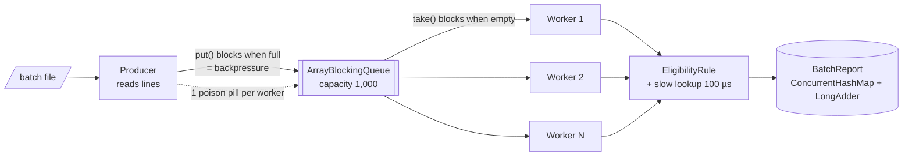
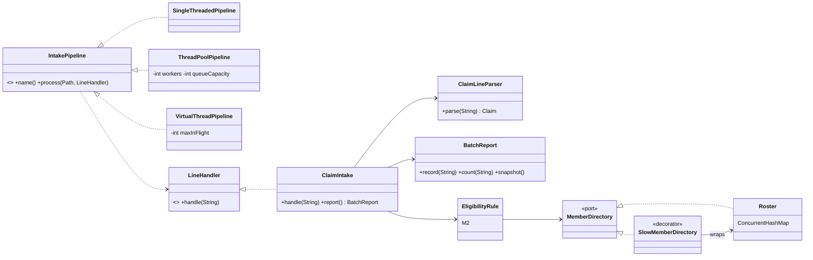
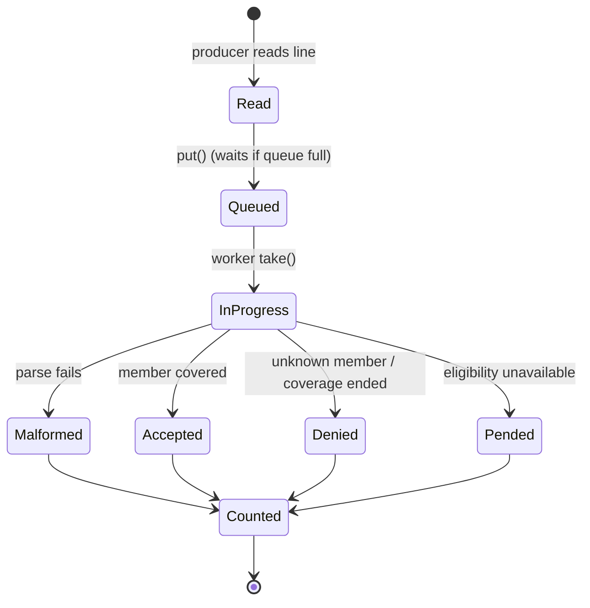
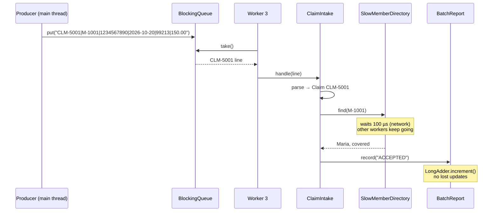
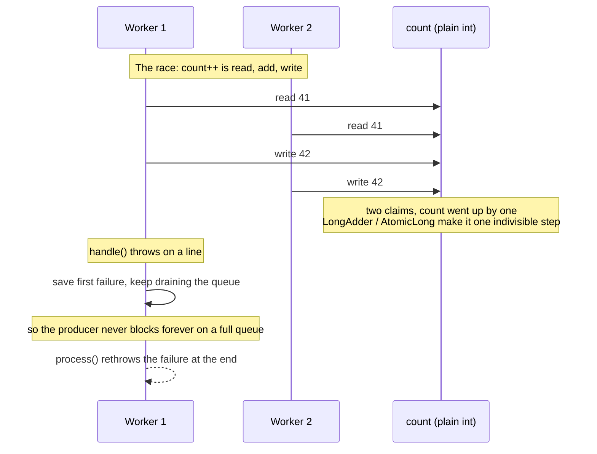

# M3 – Batch Intake (Multi-threading)

> Goal: take in a nightly file of 100,000 claims fast, without losing or double-counting a single one.
> First single-threaded, then MEASURE, then a thread pool with a bounded queue, then virtual threads.

---

## 1. 🎯 The Problem

Clearinghouses don't send claims one by one. They send **batch files** (837s) with tens of thousands of claims at
night. Every claim needs an eligibility check, which is a network call to the Eligibility Service or a database. One
thread checking claims one at a time spends almost all its time *waiting*. At 100k claims that's **19 seconds**
here, and hours with real network latency. We need many claims in flight at once, without overloading memory or the
downstream service, and without the counts going wrong.

---

## 2. 🧠 Concept in Plain English

**Analogy: a claims mailroom.**
- **Single thread** = one clerk opens an envelope, phones the eligibility desk, waits on hold, files it, then opens the
  next envelope.
- **Thread pool** = hire a fixed team of clerks. One person unloads the mail truck onto a **conveyor belt with limited
  space** (bounded queue). Clerks pick envelopes off the belt. If the belt is full, the truck unloader *waits*
  (**backpressure**), so the room never floods.
- **Virtual threads** = every envelope gets its own lightweight temp worker who costs almost nothing while on hold.
  A **ticket dispenser** (semaphore) limits how many can be on the phone at once.
- **Race condition** = two clerks update the same tally sheet at the same moment and one tick mark gets lost.

**Technically:** a thread is an independent path of execution. Platform threads map 1:1 to OS threads (about 1 MB of
stack each, expensive to switch). Virtual threads (Java 21) are scheduled by the JVM on a few carrier threads; when one
blocks on I/O, it's parked and the carrier runs another. Threads only help when work *waits* (I/O-bound). When work is
pure CPU, more threads than cores just adds overhead.

---

## 3. 📊 Diagrams

### 3a. Where M3 sits



### 3b. The producer-consumer pipeline (thread pool)



### 3c. Class diagram



The pipelines are a **Strategy** (same job, different threading); `SlowMemberDirectory` is a **Decorator** (adds
latency without changing `Roster`).

### 3d. A line's life (state)



### 3e. CLM-5001 through the thread-pool pipeline



### 3f. Failure paths: a worker throws, and the lost update



---

## 4. 🔍 Walkthrough with the Example

All code is in `batch-intake/src/main/java/com/claimstream/batch/`.

1. **The file.** `BatchFileGenerator` writes a header plus 100,000 lines like
   `CLM-5001|M-1001|1234567890|2026-10-20|99213|150.00`. Line 1 is Maria's CLM-5001. The mix is deterministic:
   1,000 lines for James (M-2002, coverage ended, like CLM-5003), 200 for an unknown member, 100 malformed, and the
   rest are covered members.
2. **One unit of work.** `ClaimIntake.handle(line)` parses with `ClaimLineParser`, runs **M2's `EligibilityRule`**
   (reused, not copied: that's the payoff of M2's ports), and records ACCEPTED, DENIED:reason, PENDED:reason or
   MALFORMED in `BatchReport`. Every pipeline calls this same method; only the threading differs.
3. **Slow lookups.** `SlowMemberDirectory` wraps the `Roster` and sleeps 100 µs per lookup, like a network call.
4. **Three pipelines.**
   - `SingleThreadedPipeline`: read, handle, repeat.
   - `ThreadPoolPipeline`: the main thread reads lines and `put`s them on an `ArrayBlockingQueue` (capacity 1,000);
     N workers from `Executors.newFixedThreadPool(N)` `take` and handle them. Poison pills stop the workers.
   - `VirtualThreadPipeline`: one virtual thread per line from `Executors.newVirtualThreadPerTaskExecutor()`,
     with a `Semaphore(1000)` so at most 1,000 lines are in flight.
5. **Thread safety.** The parser and rule are stateless. `Roster` uses `ConcurrentHashMap`. `BatchReport` uses
   `ConcurrentHashMap.computeIfAbsent` + `LongAdder`, so 64 threads can count at once without losing a tick.
6. **Same answer, every time.** All pipelines end with `{ACCEPTED=98700, DENIED:COVERAGE_TERMINATED=1000,
   DENIED:MEMBER_NOT_FOUND=200, MALFORMED=100}`. The benchmark refuses to print a row whose counts differ.

**Sizing a pool** (the formula interviewers like): `threads ≈ cores × (1 + wait time / compute time)`.
Our lookup waits ~100 µs and computes ~2 µs, so on 4 cores: 4 × (1 + 50) ≈ 200 threads would keep the CPU busy.
64 was already enough to get a 37x speed-up here.

---

## 5. 🛠 Build

| File | One-line purpose |
|---|---|
| `batch-intake/pom.xml` | New module; depends on `adjudication-engine`; builds a runnable `batch-intake.jar` |
| `IntakePipeline.java` | Strategy interface: feed every claim line to a handler |
| `SingleThreadedPipeline.java` | Baseline: one thread, one line at a time |
| `ThreadPoolPipeline.java` | Producer-consumer: bounded `ArrayBlockingQueue` + fixed `ExecutorService` + poison pills |
| `VirtualThreadPipeline.java` | One virtual thread per line, `Semaphore` caps lines in flight |
| `LineHandler.java` / `ClaimIntake.java` | The unit of work: parse, eligibility, tally |
| `ClaimLineParser.java` / `MalformedLineException.java` | Simplified 837 line ↔ `Claim`; bad lines counted, never fatal |
| `BatchReport.java` | Thread-safe tally with `ConcurrentHashMap` + `LongAdder` |
| `Roster.java` | Thread-safe member directory: Maria, James, 10,000 synthetic members |
| `SlowMemberDirectory.java` | Decorator adding network-like latency |
| `BatchFileGenerator.java` | Deterministic 100k-line file and the exact expected counts |
| `RaceConditionDemo.java` | `count++` vs `LongAdder` from several threads |
| `IntakeBenchmark.java` | Runs every pipeline I/O-bound and CPU-bound, prints the timing tables |
| Tests: `ClaimLineParserTest`, `PipelinesTest`, `BackpressureTest`, `BatchReportTest`, `SampleClaimsIntakeTest` | 22 tests |
| `pom.xml`, `intake-service/Dockerfile` | Register the module; copy its POM into the image build |

---

## 6. ▶ Run & Verify

```bash
./mvnw -pl batch-intake -am verify                 # 22 batch tests + domain + engine
./mvnw -q -pl batch-intake -am package -DskipTests
java -jar batch-intake/target/batch-intake.jar     # optional args: [claims] [lookupMicros]
```

Real output (4-core cloud machine; your Mac's numbers will differ, the shape won't):

```
Batch file: 100,000 claims, 4 CPU cores

I/O-bound: each member lookup waits 100 us
Pipeline                                Time   Claims/sec  Speed-up
Single thread                         18.87s        5,300      1.0x
Thread pool (4 threads)                5.08s       19,692      3.7x
Thread pool (64 threads)               0.50s      198,719     37.5x
Virtual threads (1000 in flight)       0.50s      201,102     37.9x

CPU-bound: member lookup is instant
Pipeline                                Time   Claims/sec  Speed-up
Single thread                          0.19s      520,931      1.0x
Thread pool (4 threads)                0.19s      534,215      1.0x
Thread pool (64 threads)               1.50s       66,592      0.1x
Virtual threads (1000 in flight)       0.16s      623,272      1.2x

Outcomes (identical for every pipeline): {ACCEPTED=98700, DENIED:COVERAGE_TERMINATED=1000,
DENIED:MEMBER_NOT_FOUND=200, MALFORMED=100}

Race condition, 4 threads x 1,000,000 increments: expected 4,000,000, count++ got 2,714,154
(lost 1,285,846), LongAdder got 4,000,000
```

**How to read it:**
- **I/O-bound:** speed-up tracks how many lookups wait *at the same time*. 4 threads ≈ 4x; 64 threads ≈ 37x.
  Virtual threads match the big pool without us choosing a pool size. (Single thread takes ~189 µs per claim, not 100:
  `sleep` always overshoots a little, as real networks do.)
- **CPU-bound:** there's nothing to wait for, so 4 cores can't go faster than ~1x of a tight loop, and **64 threads
  are 10x slower**: they spend their time fighting over the queue's lock and being switched in and out.
  More threads is not "faster"; it depends on the work.
- **Race:** a third of the `count++` increments vanished. The same bug in `BatchReport` would silently "lose" claims.

Break it on purpose: in `BatchReport`, swap the `ConcurrentHashMap<String, LongAdder>` for a
`HashMap<String, Long>` with `put(key, get(key) + 1)` and rerun `PipelinesTest`. The thread-pool rows usually fail with counts
below 5,000 (or a crash inside the `HashMap`).

---

## 7. 🎤 Interview Corner

**Q1. You need to process a 100k-claim file faster. Walk me through it.**
(STAR) *Situation:* a nightly 837 batch took ~19 s here, hours in production, because each claim waits on an
eligibility lookup. *Task:* speed it up without losing or double-counting claims or flooding downstream services.
*Action:* measured single-threaded first; split the work into a stateless per-line unit; built producer-consumer with a
bounded `BlockingQueue` and a fixed pool, then a virtual-thread version with a semaphore; made the shared tally
lock-free with `ConcurrentHashMap` + `LongAdder`; proved every version gives identical counts. *Result:* 38x faster
on I/O-bound work, same 98,700/1,000/200/100 counts every run.

**Q2. How do you size a thread pool?**
CPU-bound: about the number of cores (`availableProcessors()`), maybe +1. I/O-bound: `cores × (1 + wait/compute)`,
then measure, because the downstream service's capacity is usually the real limit. The CPU-bound table shows what
oversizing costs: 64 threads were 10x slower than 4.

**Q3. What is backpressure and why use a *bounded* queue?**
Backpressure is a slow consumer pushing back on a fast producer. With an unbounded queue, reading a file is much faster
than checking eligibility, so 100k lines (or 100M) pile up in memory until `OutOfMemoryError`. A bounded
`ArrayBlockingQueue` makes `put()` block when full; the semaphore does the same for virtual threads. Kafka consumers
(M5) get the same effect by pulling at their own pace.

**Q4. Virtual threads vs a platform thread pool?**
Virtual threads are cheap (KBs, created per task, no pooling) and ideal for blocking I/O: thousands can wait at once
on a few carrier threads. They don't make CPU work faster. Watch for *pinning* (blocking inside `synchronized` on
older JDKs ties up the carrier) and for flooding downstream services: you still need a limit, as our semaphore shows.

**Q5. What's a race condition and how do you prevent one?**
When the result depends on thread timing, typically a read-modify-write like `count++` on shared state. Fixes, in
order of preference: don't share (stateless workers, immutable data from M1), use thread-safe types
(`ConcurrentHashMap`, `AtomicLong`, `LongAdder`), or lock (`synchronized`, `ReentrantLock`) for multi-step updates.
The `BatchReportTest` proves 80,000 concurrent writes give exactly 80,000.

**System-design follow-up: "Now it's 100x: 10 million claims a night."**
One machine's threads stop being enough. Split the file into chunks and publish lines to Kafka (M5); many consumer
instances process partitions in parallel, keyed by member id so one member's claims stay in order. The bottleneck
moves to the Eligibility Service: cache it (M9) and protect it with timeouts and circuit breakers (M6). Idempotency
keys (M4) make re-processing a chunk after a crash safe.

**Common mistakes**
- Adding threads before measuring, or for CPU-bound work.
- Unbounded queues or `newCachedThreadPool()` for a 100k-item file: memory blow-up.
- `HashMap` / `ArrayList` / `count++` shared between threads.
- Swallowing exceptions inside a pool task: the batch "succeeds" with missing claims.
- Forgetting to shut down the executor, so the JVM never exits.
- Comparing pipelines without a warm-up: the first one pays the JIT's cost.

---

## 8. 📌 Remember Cards

- **Measure first**: single-threaded baseline, then change one thing at a time.
- **I/O-bound → more threads help; CPU-bound → about one per core.** 64 threads on CPU work were 10x *slower*.
- **Pool size ≈ cores × (1 + wait/compute)**, then measure.
- **Bounded queue = backpressure**: `put()` blocks when full, so memory stays flat.
- **Virtual threads** = cheap, one per task, great for blocking I/O; still cap them (semaphore).
- **`count++` is not atomic**: read, add, write. Use `AtomicLong` / `LongAdder`.
- **Thread-safe collections**: `ConcurrentHashMap`, `BlockingQueue`, `CopyOnWriteArrayList`; never plain `HashMap` across threads.
- **Same input → same counts**, whatever the threading. Test that.

---

## 9. ✅ Quick Quiz

1. In the CPU-bound table, why is the 64-thread pool *slower* than a single thread, while in the I/O-bound table it is
   37x faster?
2. What would happen to memory if `ThreadPoolPipeline` used an unbounded `LinkedBlockingQueue` and the eligibility
   lookup took 10 ms instead of 100 µs? Which line of code prevents that today?
3. `BatchReport` uses `counts.computeIfAbsent(outcome, k -> new LongAdder()).increment()`. Why not
   `counts.put(outcome, counts.getOrDefault(outcome, 0L) + 1)` on a `ConcurrentHashMap<String, Long>`, given that
   `ConcurrentHashMap` is "thread-safe"?

*(Answers held back until you reply.)*
