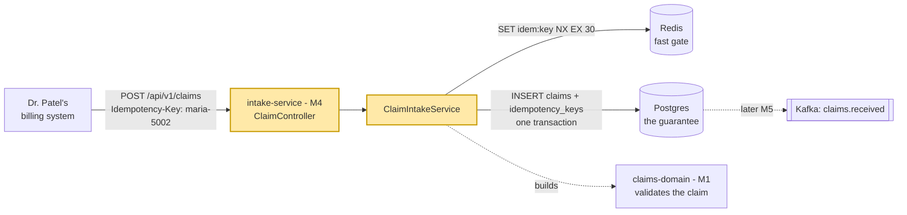
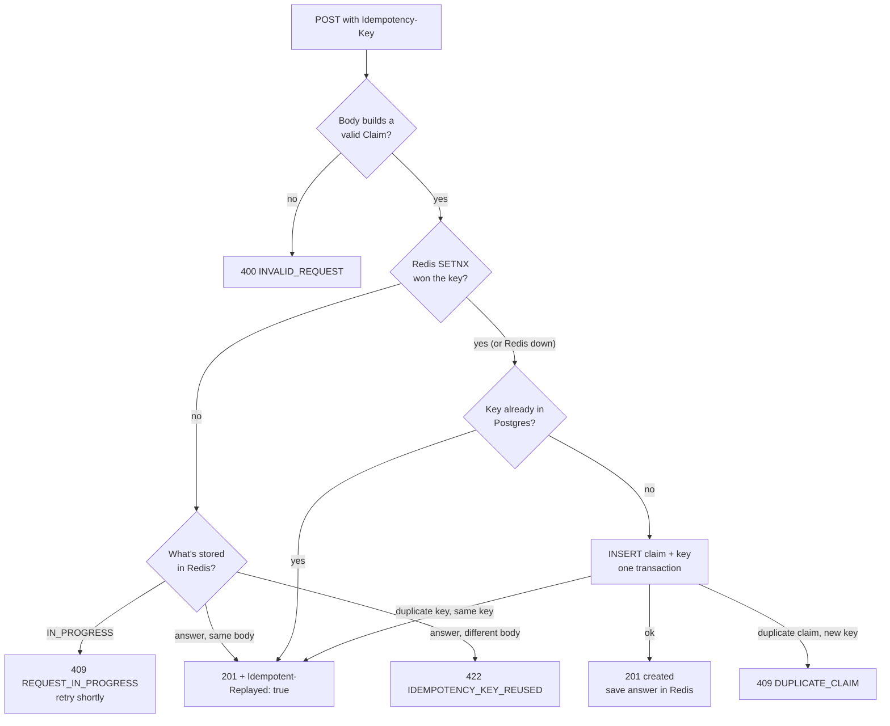
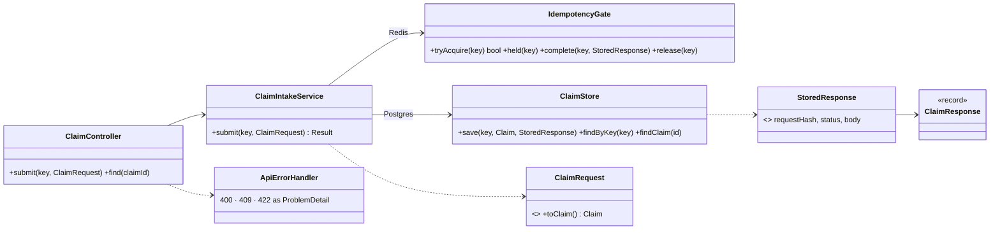
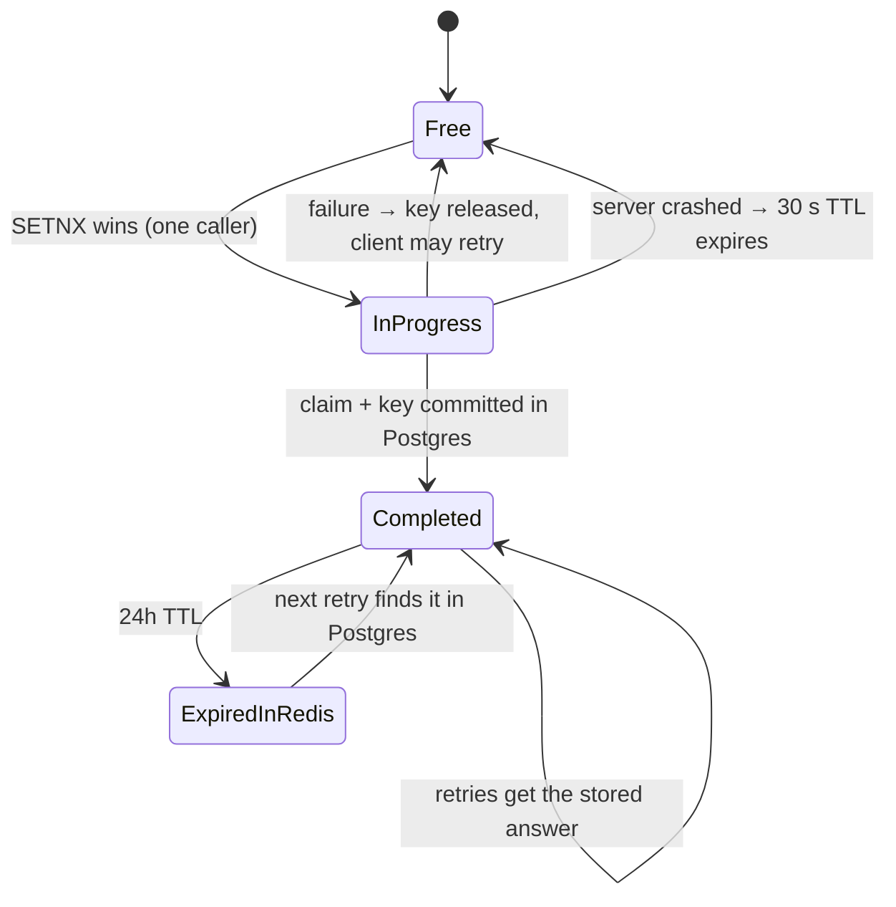

# M4 – Idempotency & Concurrency Correctness

> Goal: a REST API that stores a claim **exactly once**, even when the same request arrives 50 times at the same
> instant. Proven by a test that fires CLM-5002 from 50 threads and finds one row.

---

## 1. 🎯 The Problem

Networks fail in the worst way: the request *worked*, but the response got lost. Dr. Patel's billing system sends
CLM-5002, times out after 30 s, and retries. Its retry library is aggressive, so 50 copies arrive almost together. A
naive API stores 50 claims, and adjudication pays Dr. Patel 50 times. Payers lose real money to this. We need **"send
it as often as you like, it happens once"**, which is called *idempotency*, and it has to hold under real concurrency,
not just in a single-threaded test.

---

## 2. 🧠 Concept in Plain English

**Analogy: a coat check.**
- You hand over your coat and get **ticket #42** (the *Idempotency-Key*). If you come back and say "ticket 42", you
  get the same coat back; nobody checks in a second coat.
- If you show ticket 42 with a *different* coat, the attendant refuses (**422 key reused**).
- **Redis SETNX** is the attendant shouting "I've got 42!" so the other 49 attendants don't also start.
  It's fast, but they might forget (keys expire, Redis restarts).
- **The Postgres unique constraint** is the numbered hook on the wall: there is physically one hook #42. Even if
  every attendant forgets, two coats can't hang on it.

**Technically:** an operation is *idempotent* if doing it N times has the same effect as doing it once. `GET` and
`PUT` are idempotent by definition; `POST` is not, so we make it idempotent with a client-chosen key. The
*correctness* comes from an atomic operation that only one caller can win: a database unique constraint (or
`SELECT ... FOR UPDATE`, or a version column). Anything that "checks, then acts" in application code has a gap
between the check and the act where another thread slips in.

---

## 3. 📊 Diagrams

### 3a. Where M4 sits



### 3b. Request flow (flowchart)



### 3c. Class diagram



### 3d. An idempotency key's life (state)



### 3e. CLM-5002, 50 copies at once

```mermaid
sequenceDiagram
    participant T1 as Thread 1
    participant T2_50 as Threads 2..50
    participant R as Redis
    participant PG as Postgres
    par all fire together
        T1->>R: SET idem:retry-storm-5002 IN_PROGRESS NX
        T2_50->>R: SET idem:retry-storm-5002 IN_PROGRESS NX
    end
    R-->>T1: OK (winner)
    R-->>T2_50: nil (49 losers)
    T2_50-->>T2_50: GET → IN_PROGRESS → 409 "retry shortly"
    T1->>PG: BEGIN; INSERT claims; INSERT idempotency_keys; COMMIT
    T1->>R: SET idem:… = {hash, 201, body} EX 86400
    T1-->>T1: 201 Created
    Note over T2_50,PG: a retry a moment later → Redis has the answer → 201 Idempotent-Replayed: true
```

### 3f. Failure path: Redis is down, and the classic check-then-insert bug

```mermaid
sequenceDiagram
    participant A as Thread A
    participant B as Thread B
    participant PG as Postgres
    Note over A,B: Redis down → both let through
    A->>PG: SELECT key → none
    B->>PG: SELECT key → none
    A->>PG: INSERT claims CLM-4100
    B->>PG: INSERT claims CLM-4100 (waits on A's row lock)
    A->>PG: INSERT key; COMMIT
    PG-->>B: duplicate key on claims_pkey
    B->>PG: SELECT key → A's answer
    B-->>B: replay A's answer
    Note over A,PG: Without the PRIMARY KEY both INSERTs succeed: 2 claims, paid twice
```

---

## 4. 🔍 Walkthrough with the Example

All code is in `intake-service/src/main/java/com/claimstream/intake/claims/`.

1. **Request.** Dr. Patel's system sends `POST /api/v1/claims` with `Idempotency-Key: maria-5002` and the CLM-5002
   JSON. `ClaimController` passes both to `ClaimIntakeService.submit`.
2. **Validate.** `ClaimRequest.toClaim()` builds the M1 `Claim`. A 5-digit NPI or a $0 line throws, and
   `ApiErrorHandler` answers `400 INVALID_REQUEST`. No key is used up for a bad request.
3. **Fingerprint.** The body is hashed with SHA-256. The hash is how we spot "same key, different claim" (422).
4. **Redis gate.** `IdempotencyGate.tryAcquire` runs `SET idem:maria-5002 IN_PROGRESS NX EX 30`. Redis runs
   commands one at a time, so of 50 simultaneous callers exactly one sees `OK`. The others read the key: if it says
   `IN_PROGRESS` they get `409 REQUEST_IN_PROGRESS`; if it holds a finished answer with the same hash, they get that
   answer replayed.
5. **Postgres.** The winner checks `idempotency_keys` (in case Redis forgot), then `ClaimStore.save` inserts the claim
   and the key **in one transaction**. `claims.claim_id` and `idempotency_keys.idempotency_key` are primary keys.
   If another request somehow got here too, its INSERT blocks on the winner's row, then fails with a duplicate key,
   and we replay the winner's answer.
6. **Remember.** The answer (`{requestHash, 201, body}`) goes into Redis for 24 h and stays in Postgres forever, so
   every retry, tomorrow or next week, gets the same `201` with `Idempotent-Replayed: true`.

**Intake idempotency vs M2's DuplicateClaimRule.** Two different problems:
- *Same request delivered twice* (CLM-5002 retried 50 times): stopped here, at the door, by the key.
- *Same service billed twice under different claim ids* (CLM-5002 vs CLM-5001): a business duplicate, caught later
  by M2's `DuplicateClaimRule` during adjudication.

**Locking, in one paragraph.** We picked the simplest correct tool: a unique constraint (the database does the
locking for one INSERT). For *updates* there are two styles. **Pessimistic:** `SELECT ... FOR UPDATE` locks the row
until commit; others wait. Safe, but slow under contention and can deadlock. **Optimistic:** add a `version` column
and `UPDATE ... SET deductible_met = ?, version = version + 1 WHERE member_id = ? AND version = ?`; if 0 rows
changed, someone else won, so re-read and retry. Fast when conflicts are rare. Maria's deductible accumulator (two
of her claims adjudicated at once) is the classic optimistic-locking case; we'll need it when adjudication runs in
parallel (M5–M7).

---

## 5. 🛠 Build

| File | One-line purpose |
|---|---|
| `intake-service/pom.xml` | Adds `claims-domain` and Flyway |
| `db/migration/V1__claims_and_idempotency_keys.sql` | `claims` and `idempotency_keys` tables; primary keys are the guarantee |
| `ClaimController.java` | `POST /api/v1/claims` (requires `Idempotency-Key`), `GET /api/v1/claims/{id}` |
| `ClaimRequest.java` / `ClaimResponse.java` | JSON in and out; the request becomes a domain `Claim` |
| `ClaimIntakeService.java` | The flow: validate → hash → Redis gate → Postgres → remember the answer |
| `IdempotencyGate.java` | Redis `SET NX EX` fast path (30 s while in progress, 24 h for the answer); falls back to Postgres if Redis is down |
| `ClaimStore.java` | One-transaction insert of claim + key; replay or duplicate on conflict |
| `StoredResponse.java` | Request hash + status + body, remembered per key |
| `ApiErrorHandler.java` + 4 exceptions | 400 / 409 / 422 as RFC 9457 `ProblemDetail` with a `code` |
| `intake-service/Dockerfile` | Copies `claims-domain` sources (now a dependency) |
| Tests: `FiftyThreadsTest`, `RedisDownTest`, `ClaimApiTest`, `RaceConditionTest` | 9 new tests on real Postgres + Redis (Testcontainers) |

---

## 6. ▶ Run & Verify

```bash
./mvnw -pl intake-service -am verify      # Docker must be running (Testcontainers)
```

```
50 x CLM-5002 -> created 1, replayed 0, 409 in progress 49, rows in claims: 1
[INFO] Tests run: 12, Failures: 0, Errors: 0, Skipped: 0   (intake-service)
[INFO] BUILD SUCCESS
```

Try it by hand:

```bash
docker compose up -d --build
curl -i -X POST localhost:8080/api/v1/claims -H 'Content-Type: application/json' \
  -H 'Idempotency-Key: maria-5002' \
  -d '{"claimId":"CLM-5002","memberId":"M-1001","providerNpi":"1234567890","dateOfService":"2026-10-20",
       "lines":[{"lineNumber":1,"cptCode":"99213","billed":150.00}]}'
```

Real output from this build:

```
$ first call                        → HTTP/1.1 201   Idempotent-Replayed: false
{"claimId":"CLM-5002","memberId":"M-1001","providerNpi":"1234567890","status":"RECEIVED","totalBilled":150.00}
$ same call again (client retry)    → HTTP/1.1 201   Idempotent-Replayed: true   (same body)
$ same key, billed 999.00           → HTTP/1.1 422   "code":"IDEMPOTENCY_KEY_REUSED"
$ same claim, new key               → HTTP/1.1 409   "code":"DUPLICATE_CLAIM"

$ psql: SELECT claim_id, status, total_billed FROM claims;
 CLM-5002 | RECEIVED | 150.00          (1 row)
$ redis-cli GET idem:maria-5002 → {"requestHash":"9dee9a37…","status":201,"body":{…}}   TTL 86399
```

Break it on purpose: remove `PRIMARY KEY` from `claim_id` and `idempotency_key` in the migration *and* make
`IdempotencyGate.tryAcquire` always return `true`. `RedisDownTest` and `FiftyThreadsTest` go red with dozens of
CLM rows. `RaceConditionTest` shows the same bug in isolation, deterministically, with a `CyclicBarrier`.

---

## 7. 🎤 Interview Corner

**Q1. How would you make a payment or claim-submission API safe to retry?**
(STAR) *Situation:* clients retry on timeouts, so one claim could be stored and paid many times. *Task:* exactly-once
effect, even with 50 concurrent retries. *Action:* required an `Idempotency-Key` header; Redis `SET NX EX` as a fast
gate; claim and key inserted in one Postgres transaction with primary keys as the real guarantee; stored the response
with a request hash to replay identical retries and reject key reuse (422). *Result:* the 50-thread test stores exactly
one CLM-5002; with Redis forced down, still exactly one.

**Q2. Why not just Redis? Why not just Postgres?**
Redis alone: keys expire, failover can lose recent writes, and it isn't in the same transaction as the claim, so
"Redis says done but the INSERT failed" is possible. Postgres alone is correct and fine at moderate load; Redis
turns away 49 duplicates in about a millisecond without opening 49 database transactions. Defense in depth: fast
path + source of truth.

**Q3. Optimistic vs pessimistic locking: when do you use each?**
Pessimistic (`SELECT ... FOR UPDATE`) when conflicts are frequent or retrying is expensive; costs throughput and risks
deadlocks. Optimistic (version column, retry on 0 rows updated) when conflicts are rare, like two claims for the same
member at the same moment; no locks held while you compute. Unique constraints cover the special case "only one may
create this".

**Q4. What do you return to the 49 losers?**
While the first request is still running: `409 Conflict` ("in progress, retry"), so they don't wait on a lock or
create load. After it finishes: the *original* response (same status and body) plus a marker header. Same key with a
different body: `422`, because silently returning the old answer would hide a client bug.

**Q5. How do you test a race condition reliably?**
Make the race happen on purpose: a `CountDownLatch` "starting gun" so 50 threads fire together, or a `CyclicBarrier`
placed between the check and the insert so both threads are guaranteed to see "no row" before inserting. Assert on
the *database*, not just the HTTP codes. Never write a test that only passes when the timing is lucky.

**System-design follow-up: "100x traffic, multiple regions?"**
Partition idempotency keys by key hash across Redis Cluster shards; Postgres primary keys still guarantee one row
per partition (shard claims by member or claim id). Across regions, route a key to one home region (or use a
globally consistent store like Spanner/CockroachDB), because two regions accepting the same key concurrently
reintroduces the race. Expire old key rows with a TTL job after the retry window (e.g. 7 days). Downstream, Kafka
consumers (M5) need their own idempotency (processed-message table or outbox), since Kafka delivers at least once.

**Common mistakes**
- "Check if it exists, then insert" in Java without a unique constraint (see `RaceConditionTest`).
- Treating Redis `SETNX` as the guarantee instead of a fast path.
- Using a server-generated id as the key: the client needs to choose it *before* the first attempt.
- Replaying the old response for a *different* body instead of returning 422.
- Not releasing the key after a failure, so a legitimate retry is blocked for 24 h.
- Holding a database lock while calling another service.

---

## 8. 📌 Remember Cards

- **Idempotent** = doing it N times has the same effect as once. `POST` needs a key to get there.
- **The client picks the Idempotency-Key**, before the first attempt, and reuses it on every retry.
- **Check-then-insert is a race**; a unique constraint is atomic.
- **Redis SETNX = fast gate; Postgres unique constraint = guarantee.** Never the other way round.
- **Store the response with a request hash**: same body → replay; different body → 422.
- **Pessimistic** = lock first (`FOR UPDATE`); **optimistic** = version check, retry on conflict.
- **Intake idempotency ≠ business duplicate**: retry of one request vs two claims for one service (M2 rule).
- **Test races on purpose**: latch or barrier, assert on the database.

---

## 9. ✅ Quick Quiz

1. Redis says `idem:maria-5002` is `IN_PROGRESS`, and then the server that held it crashes before writing to Postgres.
   What does the client see on its retries, and when can it finally succeed? Why is the in-progress TTL 30 seconds
   and not 1 second?
2. In `ClaimStore.save`, a second request with the same key but a **new claim id** loses the race on the
   `idempotency_keys` primary key. Walk through what the client receives and why that's the right answer.
3. Two of Maria's claims are adjudicated at the same moment, and both add to her `deductibleMet`. Which locking style
   would you use, and what exactly does the SQL look like?

*(Answers held back until you reply.)*
