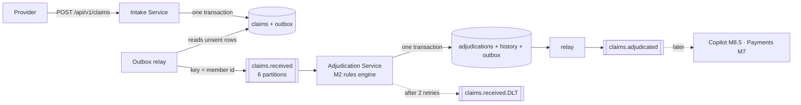
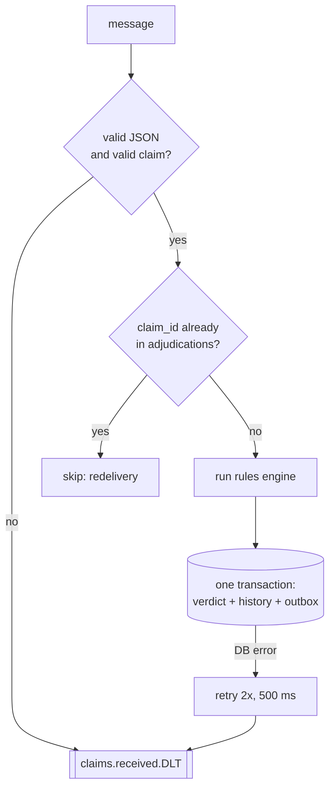

# M5 – Event-Driven Services (Kafka + Transactional Outbox)

> Goal: intake and adjudication stop calling each other. Claims travel as messages, none is lost, and none is
> decided twice, even when Kafka is down or a message arrives two times.

---

## 1. 🎯 The Problem

Until M4, a claim stopped at the front door: the Intake Service saved it and nothing happened next. If intake simply
*called* the rules engine, every slow rule would slow every provider's HTTP request, and a restart of the engine
would drop claims on the floor. At 10k claims a minute (Phase 2 target), that design breaks first.

Two harder problems hide inside "just send a message":

- **The dual write.** Saving to Postgres and sending to Kafka are two systems with no shared transaction. Crash
  between them and you have a saved claim nobody hears about, or an announced claim that was rolled back.
- **At-least-once delivery.** Kafka and our relay can deliver the same message twice. Paying twice is the bug we
  spent all of M4 preventing.

---

## 2. 🧠 Concept in Plain English

**Analogy: a post office with a logbook.**

- Old way: the front-desk clerk phones the back office for every letter and waits on hold.
- New way: the clerk writes the letter **and** a line in the logbook in one go (**outbox**). A runner reads the
  logbook and puts letters in the mailbox (**relay → Kafka**). Back-office clerks take letters from the mailbox
  when they are free (**consumers**).
- If the mailbox is closed, the logbook keeps the line; the runner tries again later. Nothing is lost.
- A letter might be posted twice. Back office checks its stamp book first: "already stamped CLM-5001? skip it"
  (**idempotent consumer**).
- A letter that makes no sense goes to a "problem letters" tray (**dead-letter topic**) so the queue keeps moving.

**Technically:**

| Term | Meaning |
|---|---|
| Topic | A named, append-only log of messages (`claims.received`) |
| Partition | One slice of a topic. Order is guaranteed only inside a partition |
| Key | Decides the partition. Same key → same partition → in order. We key by **member id** |
| Consumer group | Consumers sharing the work; each partition goes to exactly one member of the group |
| Offset | A consumer's bookmark in a partition, committed after processing |
| Outbox | A table written in the business transaction; a relay publishes its rows |
| DLT | Dead-letter topic: where messages go after retries fail |

---

## 3. 📊 Diagrams

### 3a. Where M5 sits



### 3b. The dual-write problem, and the fix

```mermaid
sequenceDiagram
    participant S as Service
    participant DB as Postgres
    participant K as Kafka
    Note over S,K: ❌ Naive: two writes, no shared transaction
    S->>DB: INSERT claim (commit)
    S--xK: send event  (crash here = claim nobody hears about)
    Note over S,K: ✅ Outbox: one transaction, then relay
    S->>DB: BEGIN; INSERT claim; INSERT outbox row; COMMIT
    loop every 200 ms
        DB->>K: relay sends unsent rows, waits for acks
        K-->>DB: ack → UPDATE outbox SET published_at = now()
    end
```

### 3c. Consumer: idempotent, with a dead-letter topic



---

## 4. 🔍 Walkthrough with the Example

1. Dr. Patel's system posts **CLM-5001** for Maria. Intake inserts the claim, the idempotency key and an outbox row
   `ClaimReceived` (key `M-1001`) in **one** transaction, and answers `201`.
2. Within 200 ms the relay sends the row to `claims.received`, waits for Kafka's ack, and marks it sent.
3. The Adjudication Service reads it, finds no verdict for CLM-5001, runs the M2 rules: allowed **$110**, all of it
   toward Maria's deductible, so the plan pays **$0**. It saves the verdict, the history row and a
   `ClaimAdjudicated` outbox row together.
4. **CLM-5002** (same visit again) → the duplicate rule finds the paid CLM-5001 in `claim_history` → **DENIED,
   DUPLICATE_CLAIM**.
5. **CLM-5003** (James, coverage ended) → **DENIED, COVERAGE_TERMINATED**.
6. Kafka is stopped, **CLM-5005** is posted: intake still answers `201`; the outbox row waits. Kafka restarts; the
   relay sends it; it is paid: plan **$56**, Maria **$54** (last $40 of deductible + 20% of $70).

Real output from that run:

```
 claim_id | status |     reason_code     | allowed | plan_pays | member_pays
----------+--------+---------------------+---------+-----------+-------------
 CLM-5001 | PAID   |                     |  110.00 |      0.00 |      110.00
 CLM-5002 | DENIED | DUPLICATE_CLAIM     |         |           |
 CLM-5003 | DENIED | COVERAGE_TERMINATED |         |           |
 CLM-5005 | PAID   |                     |  110.00 |     56.00 |       54.00
```

---

## 5. 🛠 Build

| Piece | File | What it does |
|---|---|---|
| Events | `claims-domain/.../events/ClaimReceived.java`, `ClaimAdjudicated.java`, `Topics.java` | The contract between services: plain fields, past-tense names |
| Outbox library | `event-outbox/OutboxWriter.java` | `append()` inserts a row; `Propagation.MANDATORY` fails if there is no transaction |
| | `event-outbox/OutboxRelay.java` | Every 200 ms: `SELECT … FOR UPDATE SKIP LOCKED`, send, wait for acks, mark sent |
| Intake | `ClaimStore.save()` | Adds the outbox row inside the M4 transaction |
| | `V2__outbox.sql` | `outbox` table + partial index on unsent rows |
| Adjudication | `adjudication-service/` (new) | `@KafkaListener` → `ClaimAdjudicator` (idempotent, transactional) |
| | `JdbcClaimHistory` | The engine's `ClaimHistory` port on Postgres, so all consumers share one past |
| | `KafkaErrorHandling` | 2 retries, then `claims.received.DLT`; bad JSON and invalid claims go straight there |
| | `V1__adjudications_history_outbox.sql` | Own schema `adjudication`: database-per-service on one Postgres |

**Shortcut, on purpose:** members' deductibles live in the Adjudication Service's memory (`ReferenceData`). M6 moves
eligibility to its own service and M7 makes the deductible update part of a saga.

---

## 6. ▶ Run & Verify

```bash
./mvnw verify                                   # all tests, incl. OutboxTest + AdjudicationFlowTest (Docker)
docker compose up -d --build                    # Postgres, Redis, Kafka, intake :8080, adjudication :8081

post() { curl -s -w " %{http_code}\n" -X POST localhost:8080/api/v1/claims -H 'Content-Type: application/json' \
  -H "Idempotency-Key: $1" -d "{\"claimId\":\"$2\",\"memberId\":\"$3\",\"providerNpi\":\"1234567890\",
  \"dateOfService\":\"$4\",\"lines\":[{\"lineNumber\":1,\"cptCode\":\"99213\",\"billed\":150.00}]}"; }
post k-5001 CLM-5001 M-1001 2026-10-20
post k-5002 CLM-5002 M-1001 2026-10-20
post k-5003 CLM-5003 M-2002 2026-10-20

# the verdicts
docker compose exec postgres psql -U claimstream -c \
  "select claim_id, status, reason_code, plan_pays, member_pays from adjudication.adjudications order by 1"
# the events, with their keys
docker compose exec kafka /opt/kafka/bin/kafka-console-consumer.sh --bootstrap-server localhost:9092 \
  --topic claims.adjudicated --from-beginning --property print.key=true --timeout-ms 5000
# consumer lag: how far behind adjudication is
docker compose exec kafka /opt/kafka/bin/kafka-consumer-groups.sh --bootstrap-server localhost:9092 \
  --describe --group adjudication-service
docker compose down -v
```

### 🧪 Hands-on exercises (do them in order)

1. **Kafka goes down.** `docker compose stop kafka`, post CLM-5005 (date `2026-10-21`). Is the answer still `201`?
   Run `select count(*) from outbox where published_at is null`. Start Kafka again and watch the count drop to 0 and
   CLM-5005 appear as PAID. *What would have happened without the outbox?*
2. **Send a poison pill.** `docker compose exec kafka /opt/kafka/bin/kafka-console-producer.sh --bootstrap-server
   localhost:9092 --topic claims.received` and type `hello`. Find it on `claims.received.DLT`. Then post a normal
   claim and check it still gets decided.
3. **Deliver twice.** Copy one JSON line from `claims.received` and produce it again by hand. Check the adjudication
   logs for `skipping redelivery` and that `adjudications` still has one row for that claim.
4. **Watch lag.** Stop only `adjudication-service`, post 5 claims, run `kafka-consumer-groups.sh --describe`. Note
   the LAG column. Start it again and watch LAG go to 0.
5. **Break it on purpose.** In `ClaimStore.save()`, move `outbox.append(...)` *after* the `tx.executeWithoutResult`
   block (outside the transaction). Run `OutboxTest`. What error do you get, and which annotation in `OutboxWriter`
   raised it? Why is failing loudly better than quietly sending the event? Put it back.

---

## 7. 🎤 Interview Corner

**Q1. What is the dual-write problem? How does the transactional outbox solve it?**
Writing to a database and a message broker are two separate commits; a crash between them leaves them inconsistent.
The outbox writes the event as a row in the same database transaction as the business data, so both commit or
neither does. A separate relay (polling, or CDC like Debezium reading the WAL) publishes the rows afterwards.

**Q2. Why is delivery "at least once", and what do you do about it?**
The relay can crash after Kafka acked but before it marked the row sent, and consumers can crash after processing
but before committing the offset. Both cause redelivery. Make consumers idempotent: a processed-ids check plus a
unique constraint (here, `adjudications.claim_id` primary key), all in the same transaction as the side effects.

**Q3. How does Kafka keep a member's claims in order? What breaks ordering?**
Order is per partition; the key picks the partition, so keying by member id keeps Maria's claims in order. Breaks:
changing the partition count (keys remap), multiple relays without coordination, or retrying a message out of
band (DLT reprocessing).

**Q4. What is a dead-letter topic and when should a message go there immediately?**
A parking place for messages that failed after retries, so they don't block the partition. Non-retryable errors
(bad JSON, schema violations, invalid business data) go immediately; transient ones (DB timeout) retry first.
Someone must alarm on and replay the DLT; a DLT nobody watches is data loss with extra steps.

**Q5. Polling outbox vs Change Data Capture?**
Polling is simple, needs no extra infra, adds ~poll-interval latency and DB load. CDC (Debezium on the Postgres WAL)
has lower latency and no polling queries but adds Kafka Connect to run and operate. Start with polling; move to
CDC when volume or latency demands it.

**Q6. Kafka vs SQS?** (comes up again in Phase 5)
Kafka: a replayable log, ordering per partition, consumer groups, high throughput; you run brokers (or pay MSK by the
hour). SQS: a managed queue, pay per request, no idle cost, FIFO queues for ordering per group id, no replay.

---

## 8. 📌 Remember Cards

- **Outbox = event row in the same transaction as the data.** Relay publishes later.
- **At-least-once ⇒ idempotent consumers.** Check + unique constraint, same transaction.
- **Key decides partition; order only within a partition.** Key by the thing that must stay ordered (member).
- **Commit the offset after processing**, never before.
- **Retry transient errors; DLT poison messages immediately.** Alarm on the DLT.
- **`FOR UPDATE SKIP LOCKED`** lets several relays share a table without double-sending at the same moment.
- **Database per service**, even on one Postgres server (schemas).
- **Consumer lag** is the first metric to watch on any event-driven system.

---

## 9. ✅ Quick Quiz

1. Intake saves CLM-5001 and then the JVM dies before the relay runs. Is the claim lost? What happens on restart?
2. The relay sends a batch, Kafka acks, then the relay's database transaction fails to commit. What does the
   Adjudication Service see, and why is Maria not paid twice?
3. You raise `claims.received` from 6 to 12 partitions in production. What could go wrong for a member who has two
   claims in flight at that moment?

*(Answers in the next session.)*
